# 通信途絶 / SIGNAL LOST

C++20・DirectX 11・HLSL で作った、一人称視点の探索ホラーゲームです（就職作品）。
通信が途絶えた雨の夜の研究所に入り、停電した施設で電力を戻して、同じ廊下が繰り返される建物からの脱出を目指します。

| | |
|---|---|
| ジャンル | 一人称探索ホラー（森 → 1面 → 2面） |
| 環境 | Windows x64、DirectX 11 |
| 言語 | C++20、HLSL（ゲームエンジンは使わず自作） |
| 道具 | Visual Studio 2022、Maya 2025（モデルを作るスクリプト）、Unity 6（配置エディター） |

## ゲームの画面

2026年11月26日（上の6枚）と10月31日〜11月9日の実機の自動撮影です。明るさ・色は加工していません。

| | |
|---|---|
| 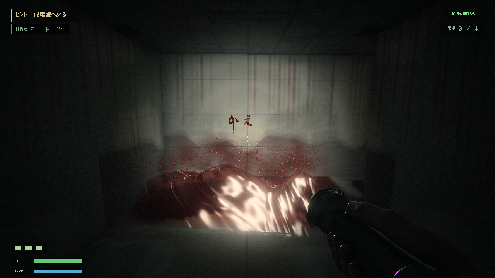 1面：廊下の奥から押し寄せる赤い濁流。壁を這い上がり、しぶきを飛ばす | 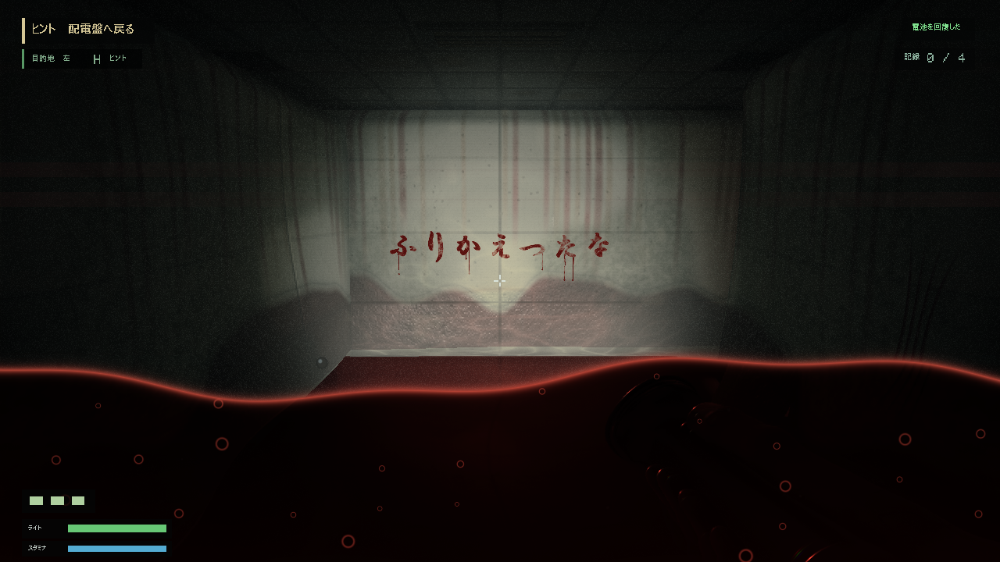 濁流に追いつかれると、画面の下から赤い水面が上がってくる |
| 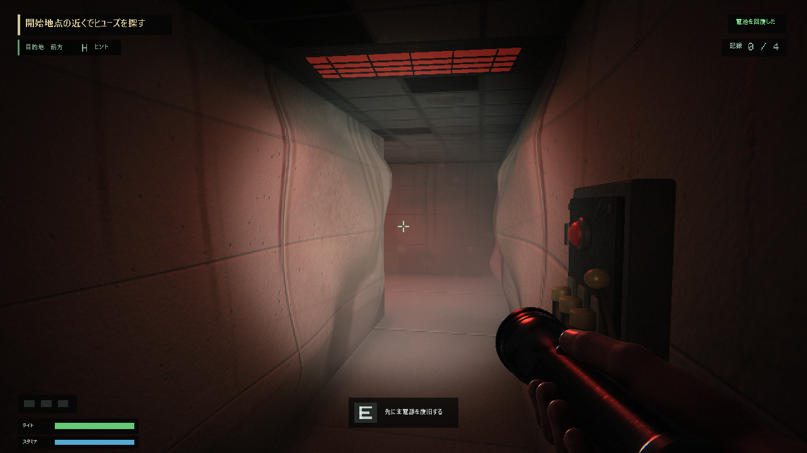 周回が進むと、廊下の壁が息をするように膨らむ | 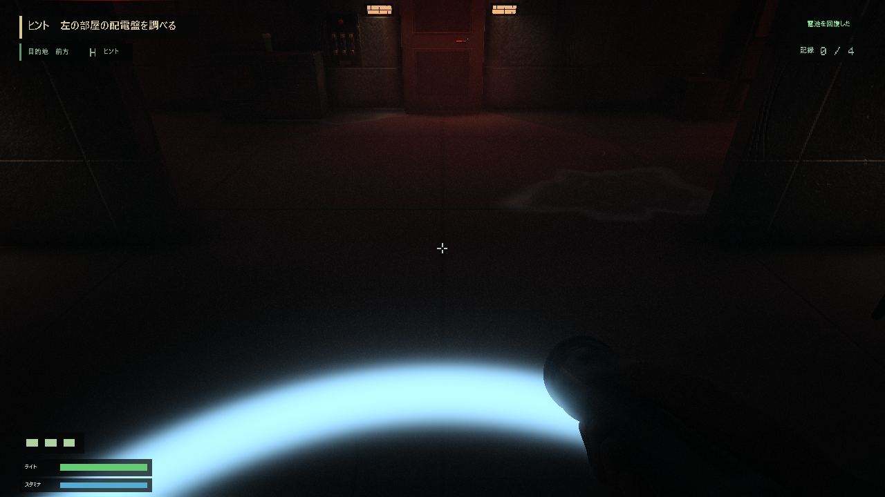 真っ暗な部屋。足音を立てたときだけ、光の輪で輪郭が浮かぶ |
| 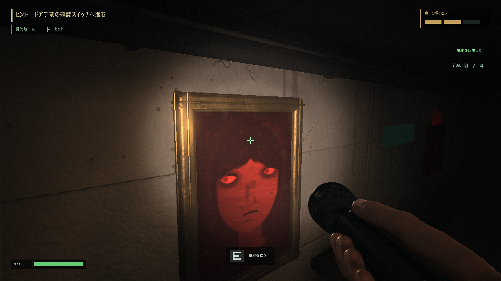 2面：見つめると目が開き、赤い瞳で追ってくる肖像画（シェーダーで描いた油絵） | 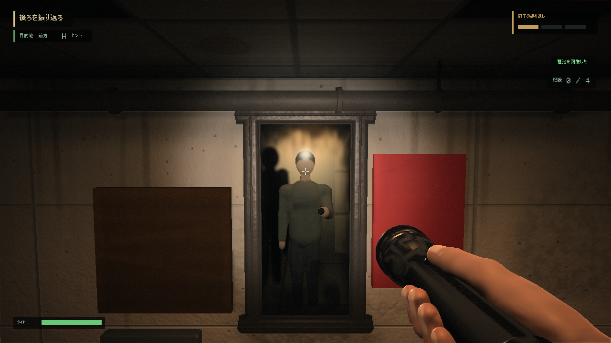 2面：鏡にだけ、自分のすぐ後ろの人影が映る |

| | |
|---|---|
| 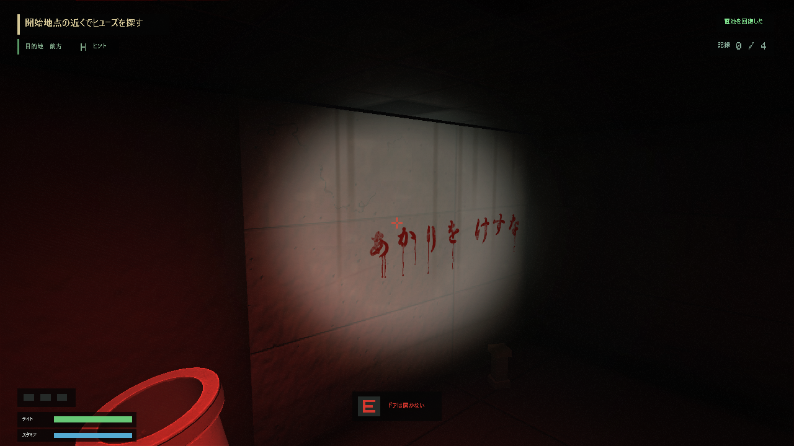 懐中電灯で照らした所だけに浮かぶ壁の文字 | 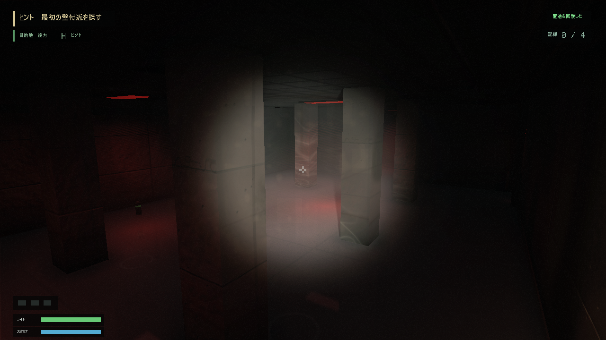 床一面が水に浸かった西棟。排水バルブで水を抜く |
| 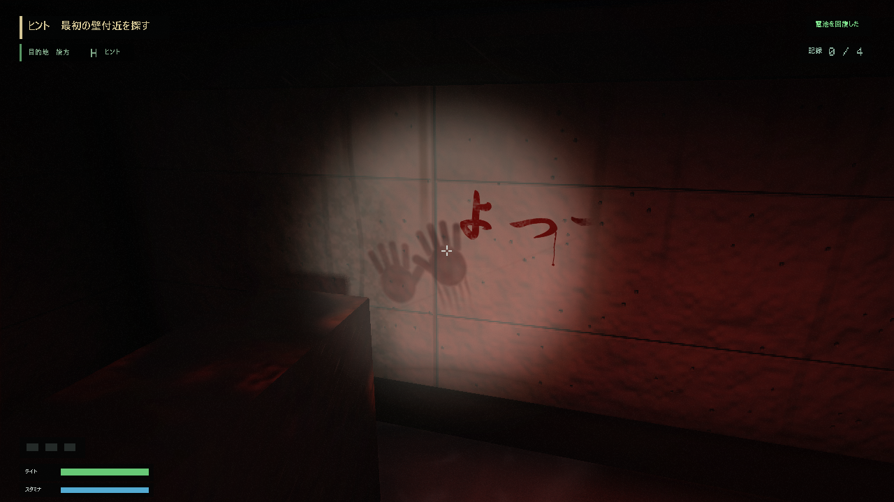 照らすと赤黒く浮かぶ血の手形と引きずった跡 | 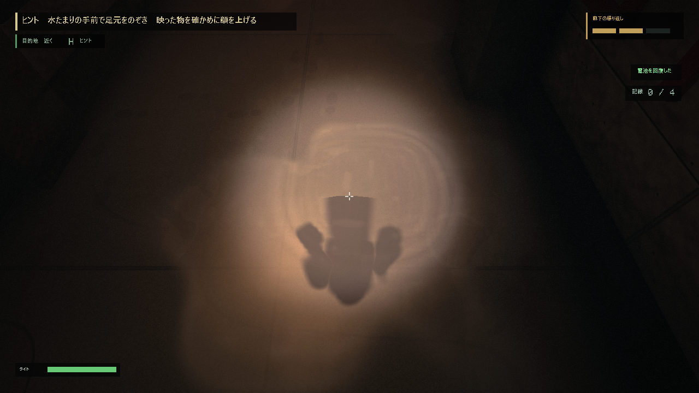 水面にだけ映る人影（レイ反射の光線と人影の距離場） |
| 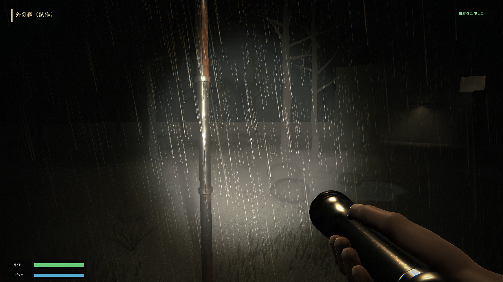 雨の森。雨粒は懐中電灯と街灯の光の中だけで光る | 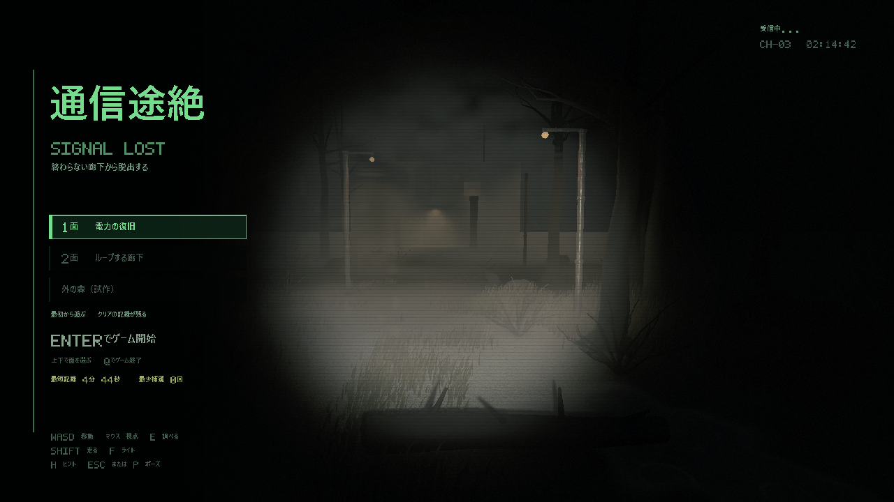 タイトル。ゲームと同じ描画で森を映す |

## 遊びの流れ

1. **雨の森**：南の小道から研究所まで歩く。無線が1行ずつ届き、研究所が見えた所で「通信途絶」になる。稲光の一瞬だけ、木の間に人影が立つ。
2. **1面（研究所の1階）**：停電した施設でヒューズを3本探して配電盤に戻し、電力を復旧して出口へ向かう。
   - 廊下の突き当たりのドアを開けると、その先は開始地点の部屋につながっている（P.T. のようなループ）。周回するたびに、建物がおかしくなっていく。
   - 3本目のヒューズは、浸水した西棟の水を抜くか、暗証番号の扉の先の閉じ込められる部屋で取るかを選べる。
3. **2面（2階）**：同じ廊下を繰り返しながら異変を見つけるループのステージ。異変はプレイごとにランダムで、見つけ方がそれぞれ違う。最後は停電の中の追跡。

タイトルでは「森から始める」「2面から始める」「森を飛ばして1面から始める」を選べます。

## 怖さの仕掛け

**1面**
- 進む方向の照明だけが切れかけの電球のようにちかちかする（矢印ではなく光で誘う）。停電しても消えない暖かい電球の下だけは、心拍と物音が静まる安全地帯。
- 懐中電灯で照らした所にだけ浮かぶ壁の文字。背を向けた隙に「ふりかえるな」が「ふりかえったな」に変わる。
- 照らしている間だけ止まり、目を離すと棚を回り込んで近づく影（書類保管室）。
- 振り返ると見ている間に伸びていく廊下、息をするように膨らむ壁（周回が進むと建物全体）、時間が止まった部屋、ゆっくり傾く部屋。
- 音を立てたときだけ輪郭が浮かぶ真っ暗な部屋。人影は最後に聞こえた音の所へ歩いてくる。
- 天井裏の足音が照明を消しながら迫ってくる追跡と、廊下の奥から押し寄せる赤い濁流（壁を這い上がり、追いつかれると視界が水に呑まれる）。
- 西棟の水面にだけ映る、天井に逆さまに張り付いた人影（見上げると何もいない）。
- 静かな時間に起こる小さな恐怖：通り過ぎた扉を内側から叩く音、懐中電灯が消えて点き直すと目の前に立つ人影、行く手の照明が1つずつ消える、一瞬だけ映る血まみれの同じ場所。出来事の後は心拍が荒くなり、視界が狭まる。
- 周回ごとに、壁のカビ・血の垂れ跡・水の跡が広がり、懐中電灯を持つ自分の手が青白く変わっていく。

**2面**
- 偽の扉・時計・肖像画（目が開いて追ってくる）・壁の向こうのノック・血の手形・鏡（自分のすぐ後ろに人影が映る）・見えない影・水たまり（水面にだけ映る人影が近づく）の異変。
- 足音を聞いて追ってくる影。ロッカーに隠れ、近くに来たら息を止める。
- 影が近いほど大きくなる携帯ラジオの雑音、映像のコマ落ち、周回ごとに赤黒く沈んでいく廊下。

## 技術の見どころ

画像素材に頼らず、模様・跡・人影の多くをシェーダーの式で描いています。

| 技術 | 使っている所 | 主なファイル |
|---|---|---|
| 懐中電灯の光（配光・レンズの模様・PCSS の柔らかい影・光の筋） | 照らした所だけ見える探索 | `flashlightLighting.hlsli`、`volumetricFlashlightPS.hlsl` |
| HDR・ACES のトーンマッピング・4段のブルーム・自動露出（Compute Shader） | 暗闇と光の差 | `toneMapPS.hlsl`、`bloomDownsampleCS.hlsl`、`PostProcess` |
| タイルベースライティング（Compute Shader、光源256個）と深度プリパス | 照明の多い施設を軽く描く | `TiledLighting`、`Renderer` |
| PBR（GGX・Smith・Schlick）と環境マップ（IBL）、使い込まれた金属 | 錆びた配管・濡れた壁の光沢 | `pbrLighting.hlsli` |
| DDGI（間接光。DirectX 11 の Compute Shader で論文の方式を実装）、SSAO、接触影 | 懐中電灯の光が周りをほんのり照らす | `DDGIVolume`、`AmbientOcclusion` |
| 水たまりのレイ反射（SSR ＋ 部屋の形との交差） | 画面の外の照明や扉も水面に映る | `puddleReflection.hlsli`、`rayReflection.hlsli` |
| 波のシミュレーション（2次元の波動方程式、Compute Shader） | 足音・水滴・雨で立つ波、壁に映る光の輪 | `WaterRippleSimulation` |
| 赤い濁流（頂点シェーダーで持ち上げる格子、背景の屈折、頂点バッファなしのしぶき粒子） | 1面の濁流 | `CorridorFloodWave`、`corridorFloodWaveShape.hlsli` |
| 距離場の人の形（3Dテクスチャとスフィアトレーシング） | 鏡と水面にだけ映る人影、鏡に映る自分 | `figureVolume.hlsli`、`mirrorPS.hlsl` |
| 解析的な影（カプセルと光線の最短距離） | 姿の見えない影が落とす影だけ | `figureShadow.hlsli` |
| 壁・床・天井の古さ（継ぎ目・ひび・カビ・錆・血の跡）を座標から計算 | 長く放置された施設、周回ごとに腐る部屋 | `wallSurface.hlsli`、`horrorMarks.hlsli` |
| 画面効果（視界の狭まり・空間のゆがみ・残像・水に呑まれる視界・一瞬だけ映る別の場所） | 恐怖を画面で伝える | `crtOverlayPS.hlsl`、`crtOverlayParts.hlsli` |
| 森の草（Compute Shader で揺れと倒れ、ベジェ曲線の葉、LOD、最大30万本）と雨（頂点バッファなし） | 雨の森 | `ForestGrass`、`ForestRain` |
| 立体音響（X3DAudio）と壁越しのこもり | 背後の足音・扉の向こうのノック | `Sound` |

設計（所有権・更新と描画の順番・状態クラスの分け方）は [ARCHITECTURE.md](ARCHITECTURE.md)、機能ごとの細かい説明・計測値・試してうまくいかなかったことは [docs/README_詳細.md](docs/README_詳細.md) にあります。

## 操作方法

| 操作 | キーボード・マウス | コントローラー |
|---|---|---|
| 移動 / 視点 | `W` `A` `S` `D` / マウス | 左スティック / 右スティック |
| 調べる（西棟のバルブは押し続ける） | `E` | A |
| 懐中電灯 | `F` | Y |
| 走る | `Shift` | 左スティック押し込み |
| 目的のヒント | `H` | LB |
| 息を止める（2面のロッカーの中） | `Space` 長押し | RB 長押し |
| ポーズ（やり直し・タイトルへ・終了、描画の設定） | `Esc` / `P` | START |

Debug 版では `F1` でデバッグ画面（ImGui）を開き、描画の切り替え・演出の値・小物の配置を確かめられます。

## ビルドと起動

1. `Job_application_work_horror.slnx` を Visual Studio 2022 で開く。
2. 構成を `Release`、プラットフォームを `x64` にしてビルドする（警告レベル /W4 で、Release・Debug とも警告0）。
3. 必要なライブラリ（Assimp・DirectXTK の SimpleMath・Dear ImGui）は `external` に同梱しているので、追加のインストールは要りません。シェーダーはビルドの最後にコンパイルされます。

確認用の起動オプション（どれもキー入力を送らず、ウィンドウを画面の外に置いて動きます）：

| オプション | 内容 |
|---|---|
| `--capture <フォルダ>` | 1面 → 2面を決めた道順で歩き、スクリーンショットと動画を保存する（`--forest` を付けると森） |
| `--benchmark <フォルダ>` | 決めた地点でフレーム時間と描画の段階ごとの GPU 時間を測る |
| `--reflection 0〜3`、`--ddgi off`、`--tonemap aces\|legacy\|reinhard` | 描画の方式を切り替えて見比べる |

配布用のフォルダは `Job_application_work_horror\tools\make-release.ps1`、提出用のソースは `Job_application_work_horror\tools\make-source-package.ps1` で作ります（どちらも `release\` に出力）。設定とベスト記録は `%LOCALAPPDATA%\SignalLost\` に保存します。

## 文書

- [ARCHITECTURE.md](ARCHITECTURE.md)：クラスの役割、所有権、更新・描画の順番、定数バッファの一覧
- [docs/README_詳細.md](docs/README_詳細.md)：機能ごとの詳しい説明・計測値・経緯（以前の README の全文）
- [docs/AI_USAGE.md](docs/AI_USAGE.md)：AI（Claude Code・Codex）をどこに使ったか
- [docs/HANDOFF.md](docs/HANDOFF.md)：作業ごとの記録
- [docs/QUALITY_BENCHMARK_20261031.md](docs/QUALITY_BENCHMARK_20261031.md)、[docs/FOREST_GRASS_BENCHMARK_20261106.md](docs/FOREST_GRASS_BENCHMARK_20261106.md)：計測の記録

## AI の利用について

2026年9月24日以降、コーディング支援 AI（Claude Code、Codex）を使っています。どの機能・ファイルに使ったかは [docs/AI_USAGE.md](docs/AI_USAGE.md) にまとめています。
