# 通信途絶

C++ / DirectX 11 / HLSLで制作した、一人称視点の短編ホラーゲームです。
暗い施設を探索して電力を復旧し、異変が繰り返される廊下からの脱出を目指します。

## ゲームの画面

2026年10月31日の実機自動撮影です。下の通常表示の画像は明るさ・色を加工していません。技術デモ・SSAO確認表示はそれぞれ明記しています。

| | |
|---|---|
| 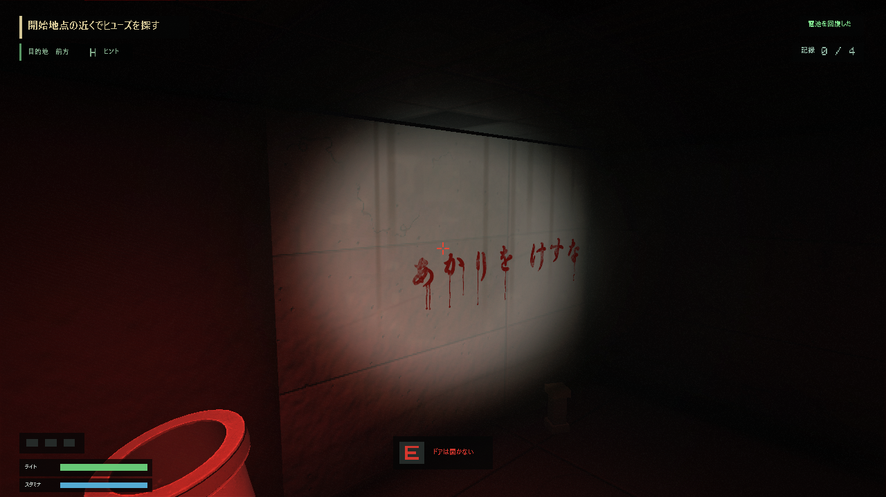<br>懐中電灯で照らした所だけに浮かぶ壁の文字 | 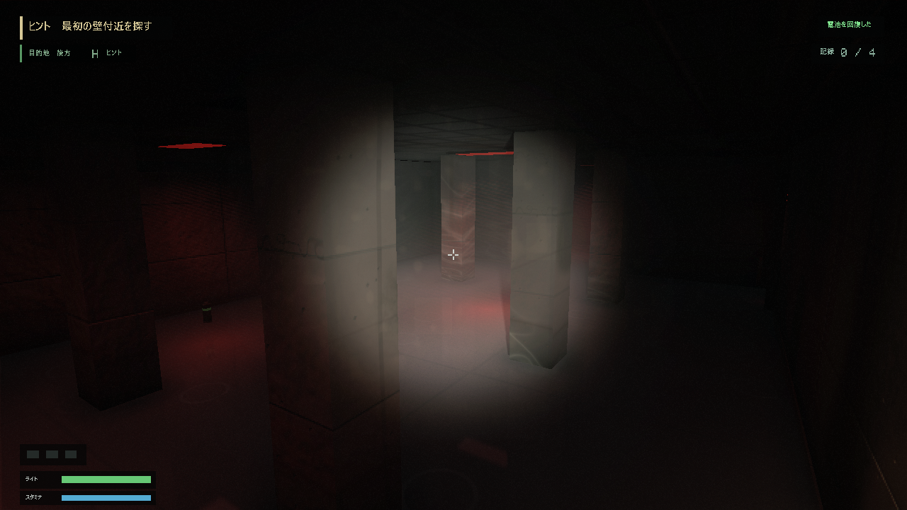<br>床一面が水に浸かった西棟。排水バルブで水を抜く |
| 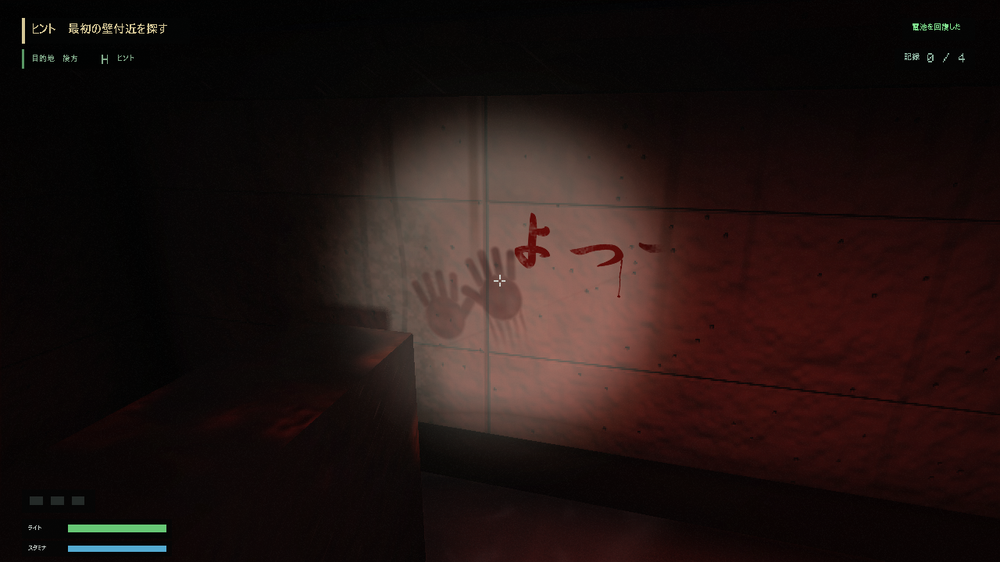<br>照らすと赤黒く浮かぶ血の手形と、引きずった跡 | 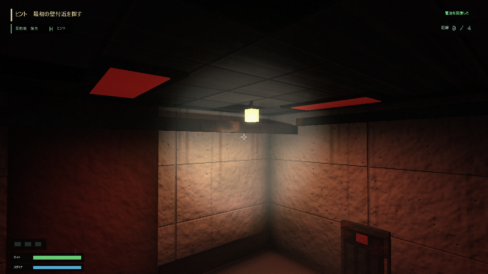<br>停電しても消えない暖かい電球の下（光の安全地帯） |
| 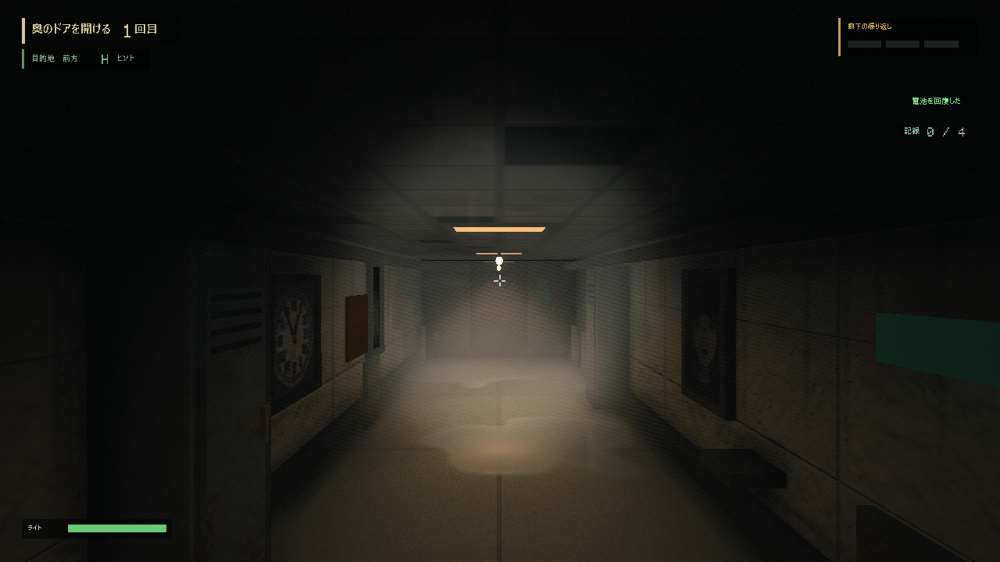<br>2面：同じ廊下を繰り返し、異変を見つける | |

## ホラーのための描画（見てほしい順）

1. **懐中電灯で照らした所だけが見える**：壁の文字、血の手形・引っかき傷・垂れ跡（`horrorMarks.hlsli`）、手元から作る影をPCSSで柔らかくした影。
   画像素材を使わず、ワールド座標と距離の式で描いている。
2. **水**：水たまりと2面の壁の鏡の反射（レイ反射。反転したカメラで景色を描き直さず、床と鏡のシェーダーで反射の光線を飛ばす。水たまりはキューブマップ・SSRと切り替えて比べられる）と、足音・水滴で立つ波（Compute Shaderの2次元の波動方程式。GPU時間は約0.012ms）。
   波の斜面が懐中電灯の光を返し、波が集めた光が壁に輪になって映る。
3. **光で導き、休ませる**：次に進む方向の電気だけが切れかけの電球のように不規則にちかちかする（矢印ではなく光で誘う）。暖かい電球の下は心拍と物音が静まる安全地帯。
4. **重さを抑える仕組み**：タイルベースライティング（光源200個で本描画が約6倍軽い）、深度プリパス、画面に映る時だけ反射を描く。
   描画方式とGPU時間の比較には、別プロジェクトの技術デモ（GraphicsTechDemo）を使う。

| | |
|---|---|
| 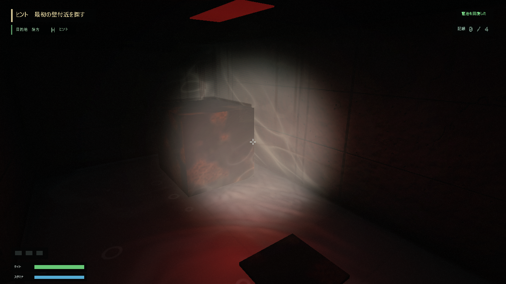<br>金属ポンプの錆・光沢と、水面から壁へ揺れる光 | 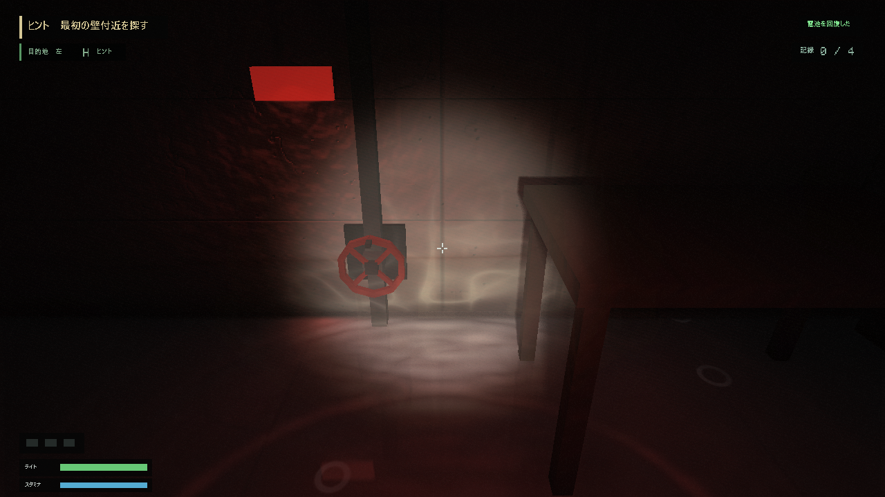<br>懐中電灯の中で光る波の輪と、浸水した西棟の水面の光の揺らぎ |
| 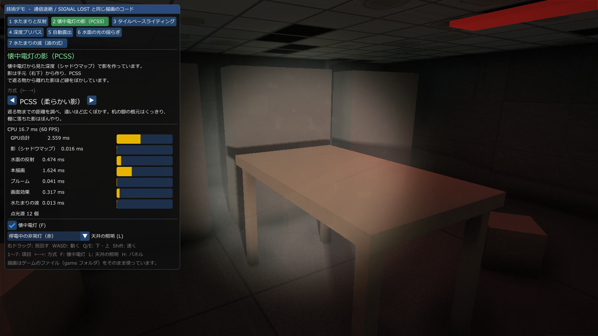<br>検証用デモのPCSS。机の足元はくっきり、離れた壁では柔らかくなる影 | |

詳しい一覧は「技術的な見どころ」、試してうまくいかなかったことと直し方は「試したことと直したこと（経緯）」にまとめています。

## 作品概要

- ジャンル：一人称探索ホラー
- 対応環境：Windows x64
- ステージ数：2
- 開発言語：C++20、HLSL
- 描画API：DirectX 11
- デバッグUI：Dear ImGui（Debug構成）

### 1面

施設内を探索して3個のヒューズを回収し、分電盤へ戻して電力を復旧します。
照明、濡れた床、水たまりの反射、影の出現などを使って探索中の緊張感を作っています。
ヒューズが部屋のどこに落ちているかはプレイごとに変わり、毎回ライトで部屋を探します。
中央のドアの先の細い廊下の突き当たりにはドアがあり、開けると、その先は開始地点の奥の壁のドアにそのままつながっています（P.T.のように、開いたドアの向こうに最初の部屋が見え、通って部屋へ入ると背後でドアが閉まる）。通るたびに廊下の様子が変わります（2本目・3本目のヒューズの手がかりもここで現れる）。電力を戻して出口の送電盤を操作すると、同じドアの上の非常口の表示が緑に変わり、そのドアを開けて通ると2面へ進みます。ドアを通って戻るたびに、開始地点の部屋は少しずつおかしくなります（壁に「おかえり」「なんど あけても ここ」「もう でられない」と1つずつ文字が浮かび、2周目からは部屋の照明が不規則に消え、通ってきたドアの向こうから叩く音がして、3周目からは取っ手もガタガタと揺れる）。
目的地の矢印とは別に、次に進む方向の天井の電気が1つだけ、切れかけの電球のように不規則にちかちかします（ほかの照明は落ち着いて点いたまま、明るさや色は同じ）。その電気の下まで歩くと、その先の電気がちかちかし始めます。
暗く冷たい施設の中に、停電しても消えない**暖かい色の電球（光の安全地帯）**が2か所あります（中央ホールの配電盤のそば、南西の広間の机）。灯りの下では心拍が静まり、姿の見えない物音が止み、画面のざらつきが和らぎます。ライトを消して休むと、電池が半分を少し超えるまで少しずつ戻ります。暗い所へ出ていく前の、緊張と緩和の「緩和」です。
長く放置された施設として、壁には打ちっぱなしコンクリートの継ぎ目・気泡の穴・ひび・上から垂れた錆の跡・床際の水位線・カビが、床には目地・染み・引きずった跡・壁際の埃が、天井には外れ落ちた天井板や雨漏りの染みがあり、部屋の隅ほど暗くなります（画像素材を使わずシェーダーで計算）。
3本目のヒューズは、**2通りのどちらで手に入れてもかまいません**（一本道にしないため）。1つは、西側の壁の扉の先にある**西棟（浸水した機械室）**の一番奥です。もう1つは、**暗証番号の扉の先の部屋**の一番奥です。施設の壁に懐中電灯でしか見えない文字で書かれた4桁の番号を探して扉を開け、閉じ込められた暗い部屋で、近づいてくる影を懐中電灯で追い払いながら鍵を探して取ります。部屋は書類棚でジグザグの通路に区切られていて、鍵は入口から見えない3か所の行き止まりのどれか（毎回ランダム）に落ちています。影は書類保管室の影と同じ格子の経路探索で棚を回り込んで来るので、細い通路で鉢合わせないよう、足音を聞きながら進みます。奥の記録端末を調べると3つの保管灯が順に点き、鍵のそばの灯だけが2回ずつ点滅します。暗証番号の部屋のヒューズは3本目を探す段階で現れ、どちらか一方を取ると、もう一方は消えます。寄り道で先に暗証番号の扉を開けていれば、3本目はその部屋へ取りに行くだけになります。西棟の道は次のとおりです。右の倉庫で西棟の鍵を拾って扉を開けると、床一面が水に浸かった、柱の並ぶ広い部屋に出ます（技術デモと同じ部屋の作り）。
ヒューズは水の底に沈んでいて、そのままでは見つかりません。赤いランプの下にある3つの**排水バルブ**を、Eキーを押し続けて回します。1つ回すごとにランプが緑に変わり、水が奥のポンプ室の排水口へ向かって引いていきます（床の水に浸かった範囲を少しずつ縮め、反射・波紋・足音・水面の光の揺らぎがそれに合わせて消える）。3つとも回して水が引くと、ポンプ室でヒューズが見つかります。
バルブを回して水が奥へ引くにつれ、浸水した水面も下がります。西棟の手前の柱には湿った帯が残り、その脇には照明を映す浅い水たまりと、鈍く光る濡れた床が現れます。

バルブを回している間は手が離せず、回し終えるたびに背後で何かが水の中を歩きます。西棟に影は出ません。水の滴る音、背後で水の中を歩く音、ヒューズを取った瞬間に入口の扉が閉まる音など、音と暗さだけで怖がらせます。
ただし、しばらく水の中を歩いてから足元の水面をのぞくと、少し先の天井に逆さまに張り付いた黒い人影が、水面にだけ映ります。見上げると天井には何もおらず、その真下の水面に滴が落ちて波紋が広がります（1回のプレイで一度だけ）。
左の倉庫の南の入口の先には、寄り道の**南西の広間**があります。柱が並ぶ暗い広間で、赤・緑・青・橙の警告灯が自分の色で周りを照らし、奥の棚と机の一角では懐中電灯の影が、根元はくっきり、離れた棚ではぼんやり落ちます（技術デモと同じ部屋の作り）。奥には電池が落ちています。
廊下の西側の書類保管室は、目線より高い棚が並ぶ迷路になっています。部屋に入ると「照らすと止まる影」が現れ、懐中電灯で照らしている間は動きませんが、光を外すと棚の間を回り込んで近づいてきます（格子の幅優先探索による経路探索）。触れられると電池を奪われるため、電池を使って照らし続けるか、目を離して迷路を進むかの駆け引きになります。

中央ホールの配電盤の横には、現在地・中央廊下・西棟を示す施設案内図があります。懐中電灯で照らすと読みやすく、廊下を一周して戻ると、図の中の奥の扉が消えています。

1面では、進む先の天井灯が少し長めに明滅します。停電中は器具だけでなく、床や壁に広がる赤い光も目印になります。

1面にはボイスレコーダーが4台あります。赤く点滅する録音機を調べると、研究員や警備員が残した3行の記録が琥珀色の字幕で流れ、再生した録音機のランプは緑に変わります。
1本目のヒューズを拾うと、しばらくして森で聞いた調査員の声が再び無線に入り、書類保管室へ誘います。棚の奥から物音がしたら、懐中電灯を向けると影が止まります。その反応を見た後で無線が「ライトを消せ」と指示するので、自分が見たことと無線の話を比べられます。

### 2面

同じ廊下を繰り返しながら変化を見つける、ループ型のステージです。
壁・天井・床は1面と同じ描画（古さ、角の暗がり、濡れた床と水たまりの反射・波）で描いています。
偽ドア、時計、肖像、傷跡、足音による危険度、信号盤パズル、追跡イベントを段階的に進めます。
1周目・2周目に見つける異変（偽ドア・時計・肖像画・壁の向こうのノック・血の手形・鏡・見えない影・水たまり）はプレイごとにランダムに変わり、それぞれ解き方が違います。肖像画は、照らして見つめ続けると、絵の中で閉じていた目が見開かれ、赤く光る瞳が見ている人を目で追います。血の手形は、壁に浮かんだ手形を懐中電灯で照らすと、奥の反対側の壁に次の手形が現れ、4つ目までたどると見つけたことになります（1面の壁の血の跡と同じ形の式で、壁のシェーダーに描いている）。
鏡の異変では、左の壁の古い鏡をのぞくと、自分のすぐ後ろに黒い人影が映っています。振り返ると、そこには誰もいません（人影は物として置かず、鏡のシェーダーが鏡の中にだけ描いている）。
鏡には自分の姿も映ります（一人称で体がないため、鏡のシェーダーが、鏡で反射した光線と体の形を交差させて描いている）。鏡の異変の周回では、鏡の中の自分だけが少し遅れて動きます。
水たまりの異変では、廊下の中央の水たまりを手前から足元へのぞき込むと、水たまりの向こう側に立つ黒い人影が、水面にだけ逆さまに映っています。のぞき続けると、人影は水を踏んで一歩ずつ近づいてきます（水面に波紋が広がり、水音が鳴る）。そばまで来られると驚かされてやり直しです。顔を上げると、そこには誰もいません。人影は物として置かず、床のシェーダーのレイ反射の光線と交差させて、水面にだけ描いています（下の技術の説明を参照）。2周目に出たときは、人影が水たまりの手前寄りのすぐ近くに立ち、速い間隔で近づいてきます。
水たまりを踏むと、乾いた床に濡れた靴の跡が数歩分残り、だんだん乾いて消えます（1面・2面）。1面では西棟の水から初めて乾いた床へ出たとき、2面では2周目以降に水たまりから出たとき、同じ水から裸足の濡れた足跡が自分の足跡のすぐ横に並んで近づいてきます。一番新しい足跡を懐中電灯で照らすと止まります。
周回で増える傷や印、偽の扉は、焦げた縁が広がるように崩れて現れ、消えます。偽の扉は、羽目板・木目・剥げた塗装・部屋番号の札「204」まで描いた、本物と見分けのつかない扉です。
天井からは雨漏りの水滴が落ち続け、真下の小さな水たまりが少しずつ広がります（1面は西棟の周り、2面は周回ごとに1か所ずつ増える）。近くでは、波紋が広がる瞬間に着水点から水滴の音が聞こえます。ほかの水たまりに落ちる水滴も、近くに落ちたものは、間を空けて少し小さな音で聞こえます。
ロッカーの中では、外の音が扉越しにこもって聞こえ、探しに来た影の低い息づかいや、ロッカーに触れる音で、すぐ外にいることが分かります。
最後の停電の追跡では、迫ってくる影が裸足の濡れた足跡を残し、通り過ぎた照明が背後から順に消えていきます。肖像画は目を見開いて逃げる人を目で追い、時計の針は狂ったように逆回りします。
影が近づくと、携帯ラジオの雑音（サイレントヒルのラジオを参考）が鳴り出し、近いほど大きくなり、画面にも雑音の線と帯のずれが走ります。姿が見えなくても、近くに何かがいることが分かります。
雑音が強くなるほど、ときどき映像が一瞬（0.05〜0.1秒）止まり、縦に少しずれて、継ぎ目に黒い帯が走ります（コマ落ち）。ポーズメニューの「演出の強さ」を下げると起きにくくなります。
2面の廊下には天井から裸電球が吊るされていて（P.T. を参考）、すきま風でゆっくり揺れ、周回が変わったときや異変を見つけたとき、影が近いときに大きく揺れて、光だまりが床と壁の上を行き来します。裸電球の光は周りの物の影を作るので、電球が揺れると、ロッカーの影も床と壁の上で揺れます。
周回が進むほど（P.T. の廊下のように）、廊下の色が少しずつ赤黒く沈み、霧が近くから濃く立ちこめていきます。扉を抜けた直後の暗転の間に、約1秒かけて変わります。
「見えない影」の異変の周回では、廊下の奥から姿の見えない何かが歩いてきます。目には見えず、近いほど強くなる携帯ラジオの雑音と心拍だけが手がかりです。雑音が強くなったら、壁際に寄って動かずに待つか、ロッカーに隠れてやり過ごします（動いていると足音の方へ寄ってきて、すぐそばまで来られると捕まります）。捕まらずにすれ違えれば、異変を見つけたことになります。
姿は見えませんが、天井の照明や揺れる裸電球の下を通ると、床と壁と、照明の下の霧（光の筋）に、人の形の影だけが落ちます。
懐中電灯で照らすと、光の帯の中に人の形の暗い切れ目が浮かび、その先の床にも影が伸びますが、照らされると気づき、3秒ほどプレイヤーの方へ速く向かってきます（照らせば位置が分かるが危ない）。
水たまりを通ると、姿は見えないまま足もとから波紋が広がり、ぴちゃりと水音が鳴ります。
ノックは立体音響だけを頼りに、音の出どころの壁を探します。
廊下には隠れられるロッカーがあり、足音を聞いて追ってくる影から隠れてやり過ごせます（近づかれてから隠れると見つかります）。見失った影はロッカーのすぐ前まで探しに来るので、近くにいる間は Space（RB）を押し続けて息を止めます。止めていないと呼吸を聞かれ、止めすぎると大きく息を吐いてしまいます。
危険が迫ると自分の心拍と呼吸が速く大きくなり（隠れている間は息を殺し、心拍だけがはっきり聞こえます）、コントローラーも心拍に合わせて震えます（1面でも、影が近いときや隠し部屋に閉じ込められている間に聞こえます）。

クリア後のリザルト画面では、評価に加えて「今回の発見」（読んだ壁の文字の数、再生した録音の数「録音 n / 4」、隠し部屋から脱出したか、2面で出た異変）を表示します。完全探索の評価には、録音4つすべての再生も必要です。

水たまりは、見下ろすと水面の下の床や波紋が見え、斜めから見ると近くの扉や壁の輪郭が映ります。浅い角度では照明や部屋も映ります。映り込みに使う前フレームの色は、カメラが動いても同じ場所を読むようにしています。

## 操作方法

| 操作 | キーボード・マウス | XInputコントローラー |
|---|---|---|
| 移動 | `W` `A` `S` `D` | 左スティック |
| 視点操作 | マウス | 右スティック |
| 調べる・操作する（西棟のバルブは押し続ける） | `E` | A |
| 懐中電灯 | `F` | Y |
| 走る（2面は最後の追跡のみ） | `Shift` | 左スティック押し込み |
| 目的ヒント | `H` | LB |
| ポーズ（1面・2面・外の森・導入の受信記録。ゲームの終了・タイトルへ戻る・やり直しもここから） | `Esc` または `P` | START |
| 息を止める（2面のロッカーの中） | `Space` を押し続ける | RB を押し続ける |
| タイトルで始める面を選ぶ（1つ目は雨の森を歩いて研究所に入る。2面から始めたプレイは記録に残らない。3つ目は森を飛ばして導入から1面を始める） | `↑` `↓`（`W` `S`）、`←` `→`（`A` `D`）、`1` `2` `3` | 十字キー、左スティック |
| タイトル開始（森を飛ばしたときは導入を挟む。導入の途中で押すと目的の画面へ飛ばし、目的の画面で押すと1面を始める） | `Enter`（導入では `Space` も） | A または START |
| タイトル終了 | `Q` | B |

遊んでいる途中に `Alt`+`Tab` などで別のウィンドウへ切り替えると、ゲームは最小化され、自動でポーズ画面を開きます（裏で敵や時間が進まないように）。最小化している間は、更新も描画も止めて PC を休ませます。

ポーズ画面の「目的表示」を「なし」にすると、目的の文章と目的地の矢印を出さない、説明のない遊び方になります。

ポーズ画面の「描画解像度」で、画面より小さい解像度で描いて軽くできます（自動 / 100% / 75% / 67%、次回起動から反映）。
「自動」は、単体GPUなら100%、内蔵GPUなら67%で描きます（HUDが収まるよう、縦720より小さくはしません）。
画面の拡大率（125%など）にも対応しており、モニター本来の解像度で描画します。
HUDは縦864の画面を基準に配置し、描画解像度に合わせて拡大縮小するため、画面の大きさや描画解像度によらず同じ比率で表示されます。

Debug構成では `F1` でImGuiデバッグ画面を表示できます。`Shader debug view` で次の表示を選べます。

- **室内を明るく＋水たまりの反射**：照明の暗さや霧を外した状態で、水たまりに映る壁や扉を確かめられます。
- **森の草LODを色で表示**：緑は近距離、黄は中距離、赤は遠距離です。描画した草の本数と区画数は「森の草」に表示します。

普段の見た目へ戻すには `Final` を選びます。撮影で使う場合は `--debug-view 11`（室内と水面反射）、`--debug-view 12`（草LOD）を指定できます。
1面の小物（棚・配管・木箱・警告灯など約60個）の配置は `assets/layout/stage1_props.txt` に書いてあり、Debug構成ではゲームを動かしたまま `F5` で読み直せ、ファイルが書き換わったとき（Unity のマップエディターで書き出したときなど）も自動で読み直します（書き間違いは行番号付きで画面に出し、前の配置のまま続けます）。
`F1` のデバッグ画面には配置エディタ（Prop Layout Editor）があり、景色の中の小物をクリックして選び、位置・大きさ・色・当たり判定・影・光を見ながら変えて、`Save to file` でこのファイルへ書き戻せます（変えた行だけを書き換え、コメントや並びは残します）。

## ビルド方法

1. `Job_application_work_horror.slnx` をVisual Studioで開きます。
2. 構成を `Release`、プラットフォームを `x64` にします。
3. 「ソリューションのビルド」を実行します。

プロジェクト設定はC++20、Platform Toolset `v143`、Windows SDK `10.0.26100.0`です。
`external` 以下にDear ImGuiなど必要なサードパーティーファイルを同梱しています。

- Assimp 5.2.5：`external/assimp` にヘッダー、Debug/Release用のlibとDLLを同梱しています。
  公式ソースを `v143`・静的CRT（`USE_STATIC_CRT=ON`）でビルドしたもので、VC++ランタイムのインストールは不要です。
  DLLはビルド後に実行ファイルと同じフォルダへ自動でコピーされます。
- シェーダー：ビルドの後に、`shader` フォルダの.hlslを自動で.csoへコンパイルします（初めての起動から待ち時間なしで始まります）。
  .hlslを書き換えた後は、ビルドし直すか、ゲームを起動すると、古い.csoが自動で作り直されます。
  作り直すのは、自分か、`#include` しているファイル（入れ子も含む）が .cso より新しいシェーダーだけで、ビルドの後は CPU のコアに分けて同時にコンパイルします（`RendererResources.cpp` の `GetShaderSourceTime`・`PrecompileShaders`）。
- Debug 版の重さ（2026年11月12日に軽くした）：D3D11 のデバッグレイヤーは、起動オプション `--d3d-debug` を付けたときだけ有効にしています（描画の命令の間違いを調べるとき。Visual Studio では、プロジェクトのプロパティの「デバッグ」→「コマンド引数」に書く）。デバッグレイヤーは描画の命令を1つずつ検査するため、CPU の時間が1フレーム1〜2.5ミリ秒増え、ときどき大きく重いフレームも出て、120Hz の画面で120fps を保てなかったためです。あわせて Debug 構成の「マイコードのみ」（Just My Code）を切りました（すべての関数の入口に入るデバッガーへの確認がなくなり、CPU の時間が15〜25%ほど減る）。計測モード（垂直同期あり、RTX 3050 Laptop、120Hz の画面）で、Debug 版も全10地点で120fps を保つようになりました（前は中央ホールで最大16ミリ秒、暗証番号の扉の前で平均約110fps）。Release 版はもともと全地点で120fps でした。
- ビルドの速さ（2026年11月10日に速くした）：`.cpp` を CPU のコア数だけ並べてコンパイルし（`/MP`）、Release のリンク時の最適化は、変わった所だけ作り直す差分の方式（`/LTCG:INCREMENTAL`）にしています。
  Release のビルドの時間（20コアの PC）は、多くのファイルが読むヘッダー（`Renderer.h`）を変えたとき 357秒 → 69秒、多くのシェーダーが読む `.hlsli`（`fastNoise.hlsli`）を変えたとき 79秒 → 29秒、1つのシェーダーだけが読む `.hlsli` を変えたとき 約79秒 → 22秒になりました（`.cpp` を1つ変えたときは約6秒で変わらず）。
- DirectXTK：使用しているのは `SimpleMath` のみのため、ヘッダーと、SimpleMath部分だけを取り出した小さなlib（Debug/Release、静的CRT）を
  `external/directxtk` に同梱しています。追加のインストールは不要です（詳細は `external/directxtk/README.md`）。

## 配布用のフォルダを作る（作品を公開するとき）

リポジトリの直下で次を実行すると、Release（x64）をビルドして、遊ぶのに必要な物だけを集めたフォルダと zip を `release\` に作ります。

```bash
powershell -ExecutionPolicy Bypass -File Job_application_work_horror\tools\make-release.ps1
```

- 作る物：`release\SignalLost_<日付_時刻>\`（と同じ名前の zip）。中身は `SignalLost.exe`・`assimp-vc143-mt.dll`・`assets\`・`shader\*.cso`（.hlsl のソースは入れない）・`cache\`（変換済みのモデル。初めての起動を速くする）・`README.txt`（遊ぶ人向けの説明）・`THIRD_PARTY_NOTICES.txt`（ライブラリと素材の一覧）・`licenses\`（ライブラリのライセンスの全文）。
- 遊ぶ人向けの説明と素材の一覧の元は、リポジトリ直下の `distribution\` にあります。公開する前に、`【要確認】` の所（作者名・連絡先・効果音の配布元など）を埋めてから作り直してください。
- ビルドに警告が1件でもあると止まります。コンパイル済みのシェーダーが足りないときも止まります。
- 最後に、配布用のフォルダの exe を、別のフォルダを作業フォルダにして自動撮影（森の道順）で動かし、最後まで動くかを確かめます（`-SkipTest` で省ける。`-SkipBuild` でビルドを省ける）。
- 前に作ったフォルダは消さず、毎回新しい名前で作ります。`release\` は `.gitignore` で外しています。
- ゲームは、exe の隣に `assets` と `shader` があるときは、exe の場所を作業フォルダにして起動します（`main.cpp` の `UseExecutableFolderWhenPackaged`）。ショートカットなど、別の場所から起動しても素材を読めます。開発中（`x64\Release` から起動）は今までどおりです。
- C++ の実行時ライブラリは静的にリンクしている（/MT）ので、遊ぶ人が VC++ ランタイムを入れる必要はありません。設定とベスト記録は `%LOCALAPPDATA%\SignalLost` に保存します。

## 技術的な見どころ

- HLSLによる懐中電灯、濡れ床、ブルーム、ビネット、フィルムグレインなどの画面表現
- ホラー向けの色調（`shader/horrorGrade.hlsli`。壁・床・壁の文字で共通）。暗い所ほど色を抜き（彩度55%）、とても暗い所をさらに沈めて、光の届かない所を灰色ではなく闇にしている。影は病的な緑がかった暗い青、明るい所は黄ばんだ古い蛍光灯の色に寄せ、遠くの霧も灰色のもやではなく闇に溶ける色にしている。環境光を下げ、懐中電灯の光の輪を狭め（11〜26度。11月5日に、審査会の「暗くて見えない」という指摘を受けて14〜32度に広げた）、電力が戻った後の天井照明も弱い緑がかった光にして、照らした所とその間の闇の差をはっきりさせている。画面の端の周辺減光を強め、暗い所ほどフィルムの粒が目立つようにしている
- 2面の周回ごとに染まっていく廊下（`Renderer::SetLoopDepth`）。何周目かの割合（0〜1）を「周回の深さ」として、デバッグ表示の定数バッファ（b7）の余りに1つ足し、色調と霧の共通処理（`horrorGrade.hlsli` の `ApplyFilmicHorrorGrade`・`GetHorrorFogColor`・`GetHorrorDistanceFog`、`horrorMist.hlsli`）に渡している。深いほど、暗い所を古い血のような赤黒に、明るい所をくすんだ橙に寄せて全体を沈め、距離の霧の始まりを近づけて濃く、床の霧と流れる霧も濃く赤黒い闇の色にしている。壁・床・壁の文字・水たまりと鏡に映る景色まで、同じ処理なのでそろって変わる。1面と2面の最初の周回は0で、これまでと同じ見た目
- 床の近くに溜まって流れる霧（`shader/horrorMist.hlsli`。壁・床で共通）。高さで薄くなる霧の量を、視線に沿って解析的に積分し、時間で流れる2層のノイズで筋やかたまりにしている。懐中電灯は目の位置にあるので、視線の方向の光の強さを霧全体に使い、光の円錐の中だけ霧が白く浮かぶ（外は闇に近い色）。懐中電灯の光の筋（ボリュームライト）にも、逆向きにゆっくり流れる2つのノイズで煙のむらを足している
- サイレントヒルと P.T. を参考にした見た目の調整。懐中電灯の光は中心が少し青みのある白で、縁へ行くほど黄色くにじむ（`GetFlashlightTint`）。部屋全体にも薄い霧を漂わせ、懐中電灯を向けた先が白くかすんで遠くが見通せないようにし、霧は近くの電球や非常灯の光を受けてその色でかすむ。2面の廊下の照明は暖かい白熱電球の色にし、電圧の揺れでときどきわずかに沈む（`CeilingLight::SetWarmBulb`）。水たまりの波は、おもりを小さく鋭くして、細い輪が何重にも広がるようにした。画面には、暗い粒と明るい粒の両方のフィルムの粒と、画面の端のわずかな色ずれを常に重ねている
- 懐中電灯を消すと、照明の光だまりの外はほとんど闇になる（環境光を下げている）。1面は通路と部屋の天井に照明を一通り並べ（停電中は赤い非常灯の光だまりが点々と続く）、暗い所でも非常灯の赤や電球の橙の色が残るよう、色調の彩度の落とし方を緩めている
- 携帯ラジオの雑音（`RadioStatic`、`tools/generate-radio-static.ps1`）。雑音は、白い雑音を1次の低域通過と高域通過で小さなスピーカーの帯域にし、電波の揺れとパチパチという粒を足して計算で合成した（外部素材なし）。影の近さから強さを求め、鳴り始めは速く静まるのはゆっくり追従させ、ループ再生した音の大きさと、画面の信号の乱れの強さに同時に反映している
- 揺れる裸電球（`HangingBulb`）。減衰する2方向の振り子をばねの式で進め、すきま風の小さな力と、外からの揺さぶり（Kick）を加える。電球の位置に点光源を置くので、揺れに合わせて光だまりが動く。大きく揺れている間は、接触の悪いソケットのように明るさが揺れる
- Compute Shaderによるタイルベースライティング（画面を16x16のタイルに分け、タイルごとに影響する点光源だけを計算。光源数の上限を8個から256個へ拡張。深度プリパスの深度からタイルの一番奥の深度を求め、壁の向こうの光源も外す）
- 深度プリパス（Zプリパス）。不透明な壁・床・扉の深度だけを本描画と同じ頂点シェーダーで先に描き、隠れた画素の重いピクセルシェーダーを省く。本描画のGPU時間が2.3〜4.8msから1.3〜1.5msに減った（RTX 3050 Laptop、1920x1080。導入前後の画面を画素単位で比べて見た目が変わらないことを確認）
- Compute Shaderによる自動露出。画面の明るさの対数平均（中央を重く）を1グループ256スレッドで求め、暗い所へはゆっくり・明るい所へは素早く目が慣れる。結果はGPUのバッファに置いたまま露出のシェーダーが読み、CPUへ読み戻さない
- X3DAudioによる立体音響（背後から近づく人影の足音、扉・配電盤の音を実際の位置から再生。壁や閉じた扉の向こうの音はローパスフィルターでこもらせる）
- 水たまりや浸水した床では、靴で水を踏んだ実録から一歩ずつ切り出した音を使います。歩きは控えめな水はね、走りは水はねが強い別の一歩です。足音の余韻を短くして、立ち止まったときに雨漏りの音が残るようにしています。出典は Joseph Sardin の [Shoes in the Water](https://bigsoundbank.com/shoes-in-the-water-s0690.html)（BigSoundBank、CC0）です。
- 1面の姿の見えない物音（天井裏を歩く足音・配管を叩く音・遠くの扉のきしみ）を、プレイヤーが見ていない方向からランダムに再生。台本の演出中は鳴らさない。配管の音は `tools/generate-pipe-knock.ps1` で合成した自作の効果音
- 効果音の差し替え（2026年11月9日）：作者が用意した効果音（MP3）を、Windows の変換でWAVにし、1歩分などを切り出してモノラル16bitにそろえた。研究所の中の足音は硬い床の1歩、外の森の足音は雨で濡れた道の1歩（歩く・走るで別の音）、扉を開ける音はきしみ、鍵のかかった扉はドアノブをがちゃがちゃ回す音、天井からの水滴は1滴の音、1面の西棟で水を抜くときは排水口へ水が抜けていく音（バルブを1つ回すごとに1回）にした。

  | 使っている所 | ファイル（`assets/Audio`） | 元の素材 |
  |---|---|---|
  | 研究所の中の足音 | `footstep_asphalt.wav` | アスファルトの上を歩く1.mp3 |
  | 外の森の足音（歩く） | `forest_step_walk.wav` | 雨で濡れた道路を歩く.mp3 |
  | 外の森の足音（走る） | `forest_step_run.wav` | 雨で濡れた道路を走る.mp3 |
  | 扉を開ける | `door_open.wav` | ドア・きしみ04.mp3 |
  | 鍵のかかった扉 | `door_locked.wav` | ドアノブ（がちゃがちゃ）02.mp3 |
  | 天井からの水滴 | `water_drop.wav` | VSQSE_0670_water_drop_04.mp3 |
  | 西棟の排水 | `drain.wav` | sei_ge_haisui01.mp3 |
- 物理ベースの材質（PBR、金属・粗さの方式。`shader/pbrLighting.hlsli`）。壁・扉・小物は、天井の照明と懐中電灯のそれぞれについて、GGXの法線分布・Smithの遮蔽・Schlickのフレネルで鏡面反射を計算し、拡散反射と分けて足している。金属は拡散反射を持たず、色がそのまま映り込みの色になる。濡れた所は粗さを下げ、湿った壁に冷たい光沢が出る。小物の金属らしさと粗さは、配置ファイルの色の行（`metal 粗さ 金属らしさ` ／ `rough 粗さ`）で色ごとに決めている（錆びた配管・棚の鋼・塗装した配管・ニスの木の机・真鍮の取っ手・金箔の額縁など）
- 環境の映り込み（IBL）。カメラの位置から6方向を撮ったキューブマップ（環境マップ）を1フレームに1面ずつ撮り直し、縮小画像（ミップ）を作って、粗い面ほどぼやけた段を読む。懐中電灯の向きは面ごとの視点へ回して渡し、照らしている壁が金属に映るようにしている。映り込む割合は解析的な近似（Karis 2014）で求めている。撮り直しのGPU時間は約0.12ms（RTX 3050 Laptop、1920x1080）。Debug構成のデバッグ画面の「Shader debug view」で、材質（赤 = 金属らしさ、緑 = 粗さ、青 = 濡れ具合）を色で確認できる
- 使い込まれた金属（`GetMetalWear`）。金属らしさのある面だけに、ワールドの位置から作ったノイズで、錆（床に近いほど多い。鉄は赤茶、真鍮や金は黒ずむ。錆は金属でなく、ざらざら）・斜めの細い擦れ傷（地の金属が出て、なめらかに光る）・拭き跡の光沢のむらを付け、色・金属らしさ・粗さを場所ごとに変えている。錆は少し盛り上げて法線も傾けている
- 揺れる裸電球の影（点光源の影。`PointShadowMap`、`shader/pointShadow.hlsli`）。カメラに近い方の電球から6方向を撮り、深度ではなく「電球からの距離」をキューブマップに書いて、壁と床で自分の距離と比べている（4か所を少しずらして読み、縁を柔らかくする）。電球は毎フレーム揺れるので6面とも毎フレーム描き直し、光の届く範囲の外の物は省いている。定数バッファの番号がすべて埋まっているため、懐中電灯の影の定数バッファ（b8）に電球の位置と範囲を足している
- 天井の照明から落ちる光の筋（`GetLightShafts`）。視線が各照明の光の届く球を通る区間のうち、照明より下の部分だけを5点で調べ、下向きの円錐の中の霧が光る量を足している。調べる位置を画素ごとにずらして（インターリーブド・グラディエント・ノイズ）縞を防ぎ、ゆっくり流れるノイズで光の筋にむらを付けている。明るいほど伸びを抑え、照明の真下を見通しても白く飛ばないようにしている。天井の近くの照明だけを対象にしている（肖像画などの面に付いた光源では、その面だけが明るくなりすぎたため）
- 画面空間の環境遮蔽（SSAO。`AmbientOcclusion`、`shader/ambientOcclusionCS.hlsl`）。深度プリパスの深度から、Compute Shaderで画素の位置と法線を復元し、法線の向きの半球に散らした12点が物に埋もれているかを調べて、棚の下・ロッカーと壁の間・柱の根元・壁と床の境目を暗くしている。標本の向きは4x4の模様で回し、深さの近い画素どうしだけで平均するぼかしで模様を消している。軽くするため縦横半分の解像度で計算し（約0.3〜0.4ms）、環境光と天井の照明には全部、懐中電灯には一部だけ掛けている。反射や環境マップなど、本描画以外の視点では使わない
- 壁を伝う水の筋（`GetWallTrickle`）。湿った区間の壁を細い列に分け、列ごとに乱数で筋の有無・太さ・流れる速さを決めて、天井の際から床まで細い水の筋を流している。筋の中では薄い水の膜の上を水の粒が流れ落ち、濡れた所は暗く、粗さが下がるので、懐中電灯を当てると筋だけが細く光る
- 1面のループのドア（P.T.を参考）。突き当たりのドアを開けた瞬間に、開始地点の奥の壁にある同じ形のドアの裏側へ、ドアに対する立ち位置と向きをそのまま写して移している（水平に90度回す変換）。裏側には突き当たりと同じ幅・高さの通路と同じ表示を置き、移った後は奥のドアを同じ開き方で開けるので、開いていくドアの向こうに最初の部屋が見え、ドアの先がそのまま続いているように見える
- 1面の壁の文字は、懐中電灯の光が当たった部分だけに浮かび上がる（壁と同じ配光・距離減衰・シャドウマップで表示量を計算する専用ピクセルシェーダー）。ループ廊下の「ふりかえるな」は、文字に背を向けた隙に「ふりかえったな」へ書き換わる（横を見ただけでは変わらない）。文字の画像は `tools/generate-wall-writings.ps1` で生成
- 建物の壁の「古さ」（1面と2面。`litTexturePS.hlsl` の `GetWallAgeing`）。天井（下向きの面）は天井板・外れた板の穴・雨漏りの染み、床（`wetFloorPS.hlsl` の `GetFloorAgeing`）は目地・ひび・染み・引きずった跡・壁際の埃を同じ方法で描く。高さから法線を作る処理は `surfaceDetail.hlsli` で共通化。コンクリートの継ぎ目・気泡の穴・ひびを凹凸（画面上の偏微分から法線を作るバンプ）として、錆の垂れ跡・水位線・カビを色として、ワールド座標から計算する。遠くで1画素より小さくなる模様は`fwidth`で薄め、描かない面では分岐で計算を省く。古さの濃さは面ごと（`Renderer::SetWallWeathering`、1面は1・2面は0.85）、描く面は材質の印（`Wall::SetWeatheringSurface`、建物の壁と天井だけ）で決める。血の手形・引っかき傷などの決まった跡は、2面では異変と紛れないよう描かない（`SetWallWeathering` の2つ目の値）。凹凸は天井灯と懐中電灯の両方の光に反映する（11月3日に、ピクセルシェーダーへビュー行列が渡っていなかったのを直し、懐中電灯の明るさの幅と扉や家具の凹凸の強さを調整した）
- 壁に近づいたときの描画負荷を抑えています。施設案内図が覆う壁は深度プリパスで描画を省き、紙面は照明と霧を受けるつや消し材質で描きます。壁のひびやカビは模様が出る範囲で細部を計算します。
- 1面の部屋の角の暗がり（`shader/roomOcclusion.hlsli`）。画面の深度から推定するSSAOではなく、建物の壁を上から見た長方形（最大32個）と床・天井の高さを定数バッファで渡し、壁までの距離から床際・天井際・壁と壁の角の暗さを直接計算する（ノイズや画面端のちらつきが出ない）。環境光と天井灯には全部、懐中電灯には4割だけ掛ける
- 1面の壁のホラーらしい跡（`shader/horrorMarks.hlsli`）。血の手形と下へ引きずった跡、4本の引っかき傷、上から垂れて先に雫がたまった血を、線分と楕円の距離関数で画像素材を使わずに描く。壁に沿って幅70ごとに区切ったマスの4割弱にだけ置き、マスの乱数に壁の面の位置も混ぜて、平行な別の壁に同じ跡が並ばないようにしている。暗い施設では懐中電灯で照らした所だけが見えるので、照らすと赤黒い跡が浮かび、血は濡れて浅い角度で光を返す
- 1面の暗証番号の扉（任意探索）。4桁の番号はプレイごとにランダムに決まり、施設の壁に懐中電灯でしか見えない文字で書かれている。扉の先は入れなかった部屋で、入ると閉じ込められる。暗闇で鍵を探し、近づいてくる影はライトで追い払う
- Planar Reflectionによる水たまりの反射。浮いた埃や油膜を表すノイズで水面の荒さを場所ごとに変え、荒い所ほど反射を縦に伸ばしてぼかす（濡れた床に映る照明が縦に伸びて見える現象）
- 2面の壁の鏡（`shader/mirrorPS.hlsl`）。11月1日に、鏡の面で反転したカメラから景色をもう一度描く方式をやめ、水たまりと同じレイ反射にした（共通の処理は `shader/rayReflection.hlsli`）。目から鏡の点への光線を鏡で反射させ、部屋の形（壁を上から見た長方形と、床・天井の高さ）とカメラに近い小物の箱16個にスラブ法で当て、画面に映っている物はSSRで拾う。鏡は下向きの光線も多いため、床の高さとの交差を足し、小物の箱も上下どちら向きの光線でも当たるようにした。鏡に映る自分の体（`MirrorSelf`）は、懐中電灯を前に持った立ち姿の距離場（色つき。下の「距離場の人の形」）に光線を通し、当たった所の法線（距離場の勾配）で天井の照明と、鏡で跳ね返った懐中電灯の光を当てる。歩く速さに合わせて脚と左腕を前後に振り、鏡の異変の周回では、記録した過去の姿勢から0.45秒遅れて動く。鏡の異変の人影は物として置かず、水たまりの人影（`TracePuddleFigure`）と同じく、人影の距離場に光線を通し、形に一番近づいた距離から輪郭のぼけた黒い影にして重ねる（自分の体との前後も比べる）。位置と向きは定数（b12 の `MirrorSelf`・`MirrorFigure`）で渡す。古い鏡らしく、縁から銀が剥げた黒いしみ・くもり・ガラスのうねり（面の向きをノイズでわずかに揺らす）と、懐中電灯を正面から当てたときの照り返しを足している。計測モードの鏡の前（ライトON）では、GPU合計が4.66msから3.29msになった（鏡の描き直し1.30msがなくなり、本描画は2.70msから2.65ms）。鏡が画面の端に入るだけの廊下の奥でも、0.4ms前後の描き直しがなくなった。景色を描き直さない分、鏡に映る壁や天井は箱の形と一色の照らし方になり、細かい模様は映らない
- 2面の肖像画は、テクスチャを使わずにシェーダーで描いた古い油絵（`shader/portraitPainting.hlsli`）。顔・髪・服・閉じた目・無表情な口を楕円と曲線の距離で描き、筆の跡のノイズ、ずらした格子の点で作る絵の具のひび割れ（クラクリュール）、剥がれ、ニスの黄ばみを重ねる。照明・影・霧は壁と同じにするため、壁のピクセルシェーダーを `PORTRAIT_SURFACE` を付けて読み込み（`portraitPS.hlsl`）、元の色だけを差し替えている。目は、開き具合・瞳の向き・赤い光をマテリアルの使っていない値（環境の色）で受け取り、閉じた線から見開いたアーモンド形まで開き、瞳は見ている人の方へ動く（肖像画の異変）
- 2面の時計の文字盤も、同じ作りでシェーダーで描いている（`shader/clockFace.hlsli`）。真鍮の縁、黄ばんだ文字盤と染み、60本の目盛り、線分の距離で描くローマ数字（I・V・X の組み合わせを2ビットずつ表で持ち、一番近い数字だけを計算）、青く焼けた針、ひびの入ったガラス。針の角度は、肖像画の目と同じくマテリアルの使っていない値で受け取る
- 2面の偽の扉の板も、同じ作りでシェーダーで描いている（`shader/doorPainting.hlsli`）。角を丸めた四角の距離で描く6枚の羽目板と段差の凹凸、縦に流れる木目、ノイズのしきい値で描く剥げた塗装、7本の線で描く部屋番号、取っ手の側に合わせた鍵穴
- 外の森の岩の PBR の材質（`shader/rockSurface.hlsli`・`rockPS.hlsl`）。岩のモデル（`forest_rock`）は UV を持たないため、x・y・z の3方向から投影したノイズを面の向きで混ぜ（トライプラナー）、どの向きの面でも模様が伸びないようにしている。色むらと地層の縞、尾根の形のノイズを細かいノイズで折り曲げたギザギザのひび（へこみ・暗さ・粗さ）、上を向いた面の苔（暗い緑で粗い）、横の面の地衣類の斑点、地面との境目の湿り（暗く、濡れて粗さが下がる）を、色・粗さ・濡れ具合・凹凸の高さとして付けている。ところどころの鉱物の粒（石英や雲母）は粗さを0.18まで下げ、懐中電灯で照らすと光の芯を点々と返す（粒の位置はマス目の中でばらつかせ、水玉模様にならないようにした）。照明・影・霧は壁と同じにするため、扉・肖像画と同じく壁のピクセルシェーダーを `ROCK_SURFACE` を付けて読み込み、汚れと古さの代わりに岩の材質を使っている。粗さの元は配置ファイルの色の `rough`（`rockColor` は0.85）
- 外の森の枯れ木・倒木・枯れた茂みの樹皮の PBR の材質（`shader/barkSurface.hlsli`・`barkPS.hlsl`）。岩と同じ作りで、モデルの木目の向き（木と茂みは上、倒木は長い向き）を `Wall::UploadMaterial` がマテリアルの使っていない値（環境の色）で渡し、シェーダーはその向きを y にした座標へ回してから投影する。まわりの向きに一定の間隔で並べ、木目に沿ってゆっくり揺らして所々で途切れさせた縦の溝、溝の間の板ごとの色の違いと短い横のひび（板の端へ向かって細くして消す）、木目に沿った細かな繊維、樹皮が剥がれて灰色に枯れた地の木が出た所（縁の樹皮は少し盛り上がる）、上を向いた面と根元の苔、地衣類の斑点、根元の湿りを、色・粗さ・濡れ具合・凹凸として付けている。値ノイズを細長く伸ばすと格子に沿って階段のような線や四角い斑点が出たため、60度回した格子のノイズと平均して格子の向きを消している
- 雨で濡れた岩と樹皮（`shader/forestWetness.hlsli`、11月10日）。外の森の雨の強さ（`ForestRain` が b7 の `RainWetness` に毎フレーム入れる）に合わせて、上を向いた面ほどよく濡れ（横の面は伝ってくる水で半分ほど、真下を向いた面はほとんど乾いたまま）、ひびや溝の低い所には先に水がたまる。濡れた所は水を吸って色が暗くなり、濡れ具合が上がって粗さが下がるので、懐中電灯の光をつやっと返す。横を向いた面には、面に沿った横の座標で細い列に分け、列ごとに乱数で決めた位置に、上から流れ落ちる細い水の筋を付けている（筋の中を、時間とともに水の粒が下へ動く。筋は少し盛り上げて、縁で光を返す）。雨を止める（`RainEnabled` を `false`）と、元の乾いた岩と樹皮に戻る
- 天井の雨漏り（`WaterEffectSystem::AddLeak`）。天井の一点から水滴が落ち続け、真下の水たまりが時間とともに広がる。水たまりの位置と半径を濡れた床の定数バッファ（b10）で渡し、縁をノイズでゆがめ、落ちてくる水滴の輪を広げている。足音の水音と反射の判定にも入れている
- 懐中電灯の光の形（`flashlightLighting.hlsli`）。反射鏡の同心円の輪、明るい中心のすぐ外の暗い輪、レンズの指紋のくもりと傷の影。電池が60%を切ると、光が暗く・黄色く・短くなり、輪のむらがはっきりする（弱り具合はスポットライトの使っていない値で渡す）
- 濡れた足跡（`WetFootprints`、`shader/wetFootprints.hlsli`）。足跡の位置・向き・左右・濡れ具合を最大32個、濡れた床の定数バッファ（b10）で渡し、床のシェーダーが靴底（つま先とかかとの楕円・溝の横縞）と裸足（くびれた足の裏と5本の指）を距離で描く。足跡は水を吸って暗くなり、懐中電灯を細く返し、約40秒で縁から乾いて消える。2面の「誰かの足跡」（`FootprintFollower`）は、水から出た場所から一歩ずつプレイヤーへ近づく
- 崩れて現れる・消える表現（`Wall::DissolveIn` / `DissolveOut`）。マテリアルの詰め物だった値を崩れ具合に使い、壁のシェーダーでワールドの位置から作ったノイズより崩れ具合が大きい画素を捨て、残った縁を焦げて燃えるように光らせる。崩れている途中の物は深度プリパスに描かない
- 水たまりの反射の方式の比較（単独の技術デモで切り替える。ゲーム本体の計測モードは `--reflection 0〜3`）。反射なし、キューブマップ（`ReflectionProbe`。カメラの位置から6方向を撮り、1フレームに1面ずつ撮り直す。0.03msと軽いが、近くの物は映る位置がずれる）、SSR（`ScreenSpaceReflection`。深度プリパスの深度を写し取り、床のシェーダーで反射の光線を画面の深度に沿ってたどり、前のフレームの画面から色を読む。景色を描き直さないが、画面に映っていない物は映らない）。ゲームの普段の方式はレイ反射（下）。以前あった平面反射（反転したカメラで景色を描き直す方式）は、11月1日にコードごと外した
- 水たまりのレイ反射（`shader/wetFloorPS.hlsl` の `TraceRayReflection`。ゲームの普段の方式）。上下を反転したカメラで景色をもう一度描く平面反射をやめ、床のシェーダーの中で反射の光線を飛ばしている。画面に映っている物（扉・ロッカー・小物・照らした壁）はSSRで拾い、外れた所は、部屋の形（部屋の角の暗がりに使っている、壁を上から見た長方形32個と天井の高さ。b11）との交差をスラブ法で求めて埋める。当たった天井・壁は点光源と懐中電灯で照らし、照明の器具は光線が光源のそばを通った分だけ光らせるので、床を見下ろして画面の外にある真上の電球や非常灯も、水たまりの正しい位置に映る（SSRだけでは映らなかった）。光線から遠い光源は二乗の距離で先に飛ばし、SSRはたどる回数を20回にして軽くしている。計測モード（止まった視点）のGPU合計は、平面反射と比べて多くの地点で0.1〜0.3ms少なく、床一面が水の西棟だけ0.6ms多い。平面反射は止まっている間は描き直しを間引いているため、歩いている間は1回0.4〜2msの描き直しが毎フレーム入り、その分がなくなる。技術デモ（デモの部屋）では、GPU合計が平面反射の2.87msから2.41msになった。2面の壁の鏡も、11月1日から同じレイ反射で描いている（上）。2面の「水たまり」の異変の人影も、このレイ反射で描いている（`TracePuddleFigure`）。人影は人影のモデルと同じ形の距離場で表し、反射の光線が形に一番近づく距離から、輪郭のぼけた黒い影にしている。画面にも鏡にも描かれず、カメラを増やさずに水面にだけ映る。波の傾きをそのまま使うと人の形が崩れるため、人影に当てる光線だけ水面の揺れを3割に抑えている。異変でない周回は定数（b12 の `PuddleFigure`）の見え方が0で、計算を丸ごと飛ばしている。人影を囲む球のそばを通らない光線は、点と光線の距離だけで先に飛ばしている。
  11月13日に、SSR が一度も物に当たっていなかった不具合を直した。深度からビュー空間の奥行きを戻す式が右手系の式で、左手系のこのゲームのカメラでは奥行きがずれていたため、射影行列の [2][3]（前方の符号）を使う、どちらの手系でも正しい式にした（`rayReflection.hlsli`）。直した後は、柱・排水バルブ・ポンプなど画面に見えている物が水面に逆さまに映り、当たった所は「近くの縦の面」として見下ろしても読める強さで映す。計測モードのフレーム時間は直す前と同じだった。
  11月10日に、作者の「平面反射より濁っていて、映っていない」という意見を受けて直した。(1) 近い水たまりのSSRを20歩・1.22倍から32歩・1.14倍にし、ぶつかった位置を1つ前の歩幅との間で5回の二分探索で詰めるようにした（以前は大きな歩幅のまま色を読み、映る物がずれてぼけ、外れた所は部屋の形の一色の灰色で埋まっていた）。(2) SSRの当たりを歩数に比例して薄めていたのを、歩数の上限に近い遠くの当たりだけ薄めるようにした（以前は近くの当たりも部屋の形の灰色と混ざっていた）。(3) 映り込みの強さを、真上から見ても4割（以前は2割強）、汚れのむらで弱める量を最大2割（以前は4割）にした。(4) 床の近くの霧を反射の上から全部かけていたのを、よく映る所だけ4割弱めた（ライトの中で映り込みが白く濁っていた）。(5) 反射の光線を、波立った水面の向き（細かい波の模様・足音の波・床の凹凸）のまま飛ばしていたのを、真上に波の傾きを3割だけ足した向きで飛ばすようにした（平面反射の頃も、平らな水面で映してから少しだけ揺らしていた。光沢と光る輪には元の波の向きを使う）。(6) 画面の外の壁・天井（部屋の形）が一色の灰色だったのを、コンクリートのパネルの継ぎ目と色むら、天井板の格子と染みを当たった位置から計算して付けた（`GetRoomReflectionDetail`）。(7) 画面の外の物の色を、PBRの環境マップ（カメラの位置から6方向を撮った本物の景色。t14、もともと金属の映り込み用に毎フレーム1面ずつ撮っている）から読むようにした。反射の向きのまま読むと撮った位置（目）と水面の位置の違いで映る位置がずれるので、光線が部屋の形に当たった位置を目から見た向きで読んでいる（部屋の形を使った視差の補正）。環境マップが撮れていないとき（PBRを止めた技術デモ・最低の画質）は、(6) の部屋の形と模様で映す。(8) 映る物が水面から離れているほどぼかすようにした。前のフレームの画面を、縮小画像（ミップ）を持つテクスチャへ写して縮小画像を作り（`ScreenSpaceReflection::Prepare`）、SSRで当たった物までの距離60ごとに1段ぼやけた段を読む（最大4段）。環境マップも、離れた所ほど小さい段を読む。本物の水面のように、柱の根元はくっきり、離れた物ほどぼやけて映る。2面の壁の鏡はぼかさない。(7)(8) を足した後の計測モードでは、どの地点も測るたびの揺れ（±0.3ms）の中でほぼ同じだった。(9) 作者の録画で「反射がかくかくして気持ち悪い」と分かった所を直した。床を見下ろしたとき、SSR が波で傾いた光線や浅い角度の光線で、すぐ近くの床そのものに誤って当たり、懐中電灯で明るい床がギザギザの塊で映って、歩くたびに跳ねていた。床の水たまりでは、当たった所の高さを深度から戻して調べ、水面より1.5以上高くない物（床そのもの）への当たりを捨てている（床の水たまりに映るのは水面より上の物だけのため。2面の壁の鏡では調べない）。あわせて、縮小画像を引き伸ばすと四角いブロックが見えるので1段細かい画像を4方向にずらして読んで平均し、環境マップは6面を撮り終えるまで同じ位置から撮って、反射はその位置から撮った景色として読むようにした（今の目の位置として読むと、歩くたびに映り込みがずれて跳ねるため）。カメラを増やして景色を描き直す方式には戻さず、レイを飛ばす方式のままで直している。計測モードでは、床一面が水の西棟だけ本描画が約0.4ms増え、ほかの地点はほぼ同じ。SSRの変更は、2面の壁の鏡（`mirrorPS.hlsl`）と、比較用のSSR（技術デモ）にも効く
- 水たまりのメッシュと LOD（`Ground::DrawWaterSurfaces`）。以前は床全体を描く1つのシェーダーの中で、画素ごとに「水たまりか」を計算していたため、水たまりごとに描く・描かないや、遠いほど軽くすることができなかった（審査会で「水たまりはメッシュの方がいい。LOD が効かなくなる」と指摘された）。今は床の本体を乾いた床として描き、水たまり1つ（82四方のマス目1つ）・雨漏り1つ・浸水した範囲を、それぞれの形を覆う多角形のメッシュで床のわずか上に描き重ねている。メッシュは深度プリパスにも描くので、メッシュの下の床の画素は深度の判定で捨てられ、計算が二重にならない。画面の外にあるメッシュは描かない。反射は水面の画素までの距離で決め、SSRは105〜155で徐々に弱め、部屋の形から求める反射は300〜380で霧の色へ移す。水たまりと浸水のメッシュが重なる場所でも、同じ位置は同じ距離で計算する。岸の形はこれまでどおり床のシェーダー（`puddleMask.hlsli`）が決めるので、メッシュは形を覆う楕円（シェーダーの式から、岸が必ず収まる大きさを求めた）でよい。デバッグ画面（F1）の Puddle mask で、近い（緑）・中くらい（黄）・遠い（赤）を色で確かめられる。計測モードの地点では、どれも近くの水たまりを見ているため、GPU の時間はほぼ同じ（±0.05ms）
レイ反射は、画面の外の扉や小物（棚・ロッカー・柱）も映す。`Object::GetReflectionProxy` で箱と色を返し、カメラに近い16個を毎フレーム選んで b12 へ送る。床のシェーダーで3方向のスラブ法を使い、扉だけは開閉に追従する扉板の向きに光線を変換する。当たった位置から扉の鏡板を描き、建物の壁は部屋の形とコンクリートの継ぎ目で映す。
- 見えない影の「影だけ」（`shader/figureShadow.hlsli`）。姿の見えない人影は物として描いていないため、シャドウマップにも写らない。そこで人の形を胴のカプセルと頭の球で表し、天井の照明・揺れる裸電球・懐中電灯から画素へ向かう線分と、人影の芯の線分が一番近づく距離から、光が遮られる割合を壁と床のシェーダーで求めている。遮る所から画素までが遠いほど縁をぼかし（半影）、人影を囲む球に線分が届かない組み合わせは、点と線分の距離だけで先に飛ばしている。照明の下の光の筋（`shader/lightShaftsCS.hlsl`）にも同じ影を落とし、霧の中に人の形の暗い切れ目ができる。光の筋では、視線が人影の影の芯（人影の胸から床まで、光源と反対の向き）のそばを通る光源だけを調べ、霧の中の点は1点おきに、頭までカプセル1本で軽く求めている
- 1面の西棟の、水面にだけ映る天井の人影（`CeilingReflectionScare.h`）。2面の「水たまり」の異変と同じレイ反射の人影を、天井から逆さまに吊るした形で描いている（定数の見え方を負にして上下を逆にする）。見たかどうかは、人影の胸と頭を水面で反転した点へ目から引いた線が、水の中で水面と交わり、視線の中心に近いかで決めている
- 懐中電灯の光の帯の中の、見えない影の切れ目（`shader/volumetricFlashlightPS.hlsl`）。懐中電灯は目のすぐそばにあるので、目から見た人影の形がそのまま光の帯の中の影になる。画素の視線と人影の芯（胴から頭までのカプセル）が一番近づく距離をビュー空間で求め、人影より先の霧には光を届かせない
- 最後の追跡で、迫ってくる影を水面にも映している（`Stage2SceneHorror.cpp` の `UpdatePuddleAnomaly`）。影を直接見ると罰があるが、水面に映った影なら罰はない。影は物としても描いているが、画面の外にある上半身まで水面に映るよう、レイ反射の人影としても重ねている
- 映像のコマ落ち（`PostProcess`、`shader/crtOverlayPS.hlsl`）。ラジオの雑音の強さに合わせて、映像を一瞬止める。止めている間は描き終えた画面の写し取りをやめ、前のフレームの画面を、縦に少しずらし、走査線と色抜けを付けて全面に出している。HUDはその後に描くので止まらない。自動撮影と計測では起こさない
- 恐怖で視界が狭まる（`PostProcess::SetFearVision`、`shader/crtOverlayPS.hlsl`）。審査会で「インパクトが少し弱い」と言われて足した。心拍と呼吸を決めている緊張度（`TensionPulse`、影の近さや足音の危険度から求める）が、心拍が聞こえ始める高さを超えると、画面の端から、ぼけて色の抜けた闇が中央へ迫る。端の景色を中心へ向かう向きに5点読んでぼかし、白黒に寄せて暗くした色を、端ほど濃く重ねている。心拍が鳴るたびに、縁が一瞬さらに内側へ寄る。視線の中央とHUDは隠さない。ポーズメニューの「演出の強さ」で弱められ、緊張していない間は分岐で計算を丸ごと省いている（1面・2面共通。`TensionPulseFeedback.h` の `ShowFearVision`）
- 1面の西棟の水面の光の揺らぎ（コースティクス）。壁や天井の点を水面で折り返した点へ懐中電灯の光が向かっているかを配光の式で求め、光が水面に当たる点に流れる網目の模様を掛ける
- Compute Shaderによる水たまりの波のシミュレーション（2次元の波動方程式）。プレイヤーのまわりの一辺192を256x256マスに分け、2枚のテクスチャを交互に読み書きして1秒に60歩ずつ進める。足音と水滴がおもりになって輪が広がり、輪どうしが重なって干渉し、水たまりの岸（乾いた床は高さ0）と、床に立った柱・棚・机の脚（最大32個を上から見た長方形で渡す）で跳ね返る。できた高さの傾きで床の反射を波打たせて懐中電灯の光をきらっと返し、へこみ（ラプラシアン）が光を集める所を、水面で折り返した光として壁に光の輪で映す。水たまりの形は床のシェーダーと同じ式（`puddleMask.hlsli`）を使う。GPU時間は約0.012ms（RTX 3050 Laptop、技術デモで計測）
- Shadow Mapと描画対象ごとのカリング。影だけを目より少し右下（手元）から作り、物の影が画面に映るようにした上で、PCSSで遮る物から離れた所ほど影の縁を柔らかくする
- 視界内に水面がある場合だけ反射パスを更新する負荷制御
- フリップ方式のスワップチェーン（`DXGI_SWAP_EFFECT_FLIP_DISCARD`、バックバッファ2枚。使えない古いWindowsではBitBlt方式に戻す）。垂直同期ありで約31fpsに落ちて上下していたのが、120Hzの画面で120fpsにそろった（計測は「処理の重さの計測」を参照）
- モデルの変換済みの形式（`StaticMesh`）。Assimp で読んでゲームの形（頂点・インデックス・サブセット・マテリアル・テクスチャの名前）に変換した結果を、`cache/model/` にバイナリで保存し、次からはそれを読む。元のモデルの大きさか更新日時が変わったとき、形式の版や構造体の大きさが違うときは、Assimp で読み直して保存し直す（書き終えてから名前を変えるので、書きかけのファイルは読まない）。テクスチャは保存せず、これまでどおりファイル名から読む（モデルに埋め込まれたテクスチャがある物は保存しない）。Debug 版で森を開くときのモデルの読み込みが、合計約920ミリ秒から約34ミリ秒になった（懐中電灯を持つ手だけで643ミリ秒から23ミリ秒）。保存した形式から読んだ画面は、1面・森の自動撮影で Assimp で読んだときと1画素も変わらない。`cache/` は `.gitignore` で管理の対象から外しており、消せば次の起動で作り直す
- シェーダーの事前コンパイル（`Renderer::PrecompileShaders`）。ビルドの最後に実行ファイルを `--compile-shaders` で起動し、全部のシェーダー（46個）を.csoへコンパイルしている（失敗したらビルドも失敗にし、エラーを `shader/shader-compile-errors.txt` に残す）。ゲームは、.csoがシェーダーのフォルダのどの.hlsl・.hlsliよりも新しいときだけ読み、古ければコンパイルし直して保存する。タイトル画面からゲームを始めるまでに、シェーダーのコンパイルで約17秒待っていたのが、ほとんどなくなった（.csoなしで17.2秒、.csoありで1.0秒。どちらも実行ファイルの起動を含む）
- `std::unique_ptr`によるScene・Objectの単一所有
- `ComPtr`によるDirectXリソース管理
- Objectの遅延追加・遅延削除による更新ループの安全性確保
- 1面・2面のイベント進行を状態クラスへ分離
- Releaseではゲーム画面だけを表示し、DebugではImGuiで演出値や進行状態を確認可能

## 試したことと直したこと（経緯）

- **水たまりの波紋が速すぎた**：波の式の速さ（1歩あたりの波の進み）が大きく、輪が1秒で水たまりの半分ほど広がって、水らしい落ち着きがなかった。
  波の速さを約半分（毎秒約13.5）にし、その分ゆっくり消えるよう減衰を弱め、足音の輪・水滴の輪・雨漏りの波の動きもゆっくりにした。
- **グラフィックがホラーらしくない、という意見をもらった**：画面全体が明るく、色も多く、清潔なオフィスのように見えていた。
  原因は、環境光（懐中電灯の光の外の明るさ）が高く、遠くの霧が明るい灰色で、色調の補正も控えめだったこと。
  色調を共通の処理（`horrorGrade.hlsli`）にまとめ、彩度を落として暗い所を沈め、霧を闇の色に、環境光と照明を弱め、懐中電灯の光の輪を狭めた。
  照らした所に何があるかは読めるよう、明るい所の色は少し残し、進む方向の照明のちかちかや信号盤の光る色は残している。
- **水たまりが、PCによって消えていた**：水たまりを置く場所を、シェーダーの中で `sin` を使った乱数で決めていた。`sin` の精度はGPUの種類で違うため、別のPCでは同じ式でも違う値になり、水たまりが消えた。
  置く場所をCPUで計算した表（16x16マス）にして定数バッファ（b13）で渡すようにし、どのGPUでも同じ場所に出るようにした。
- **水たまりの波紋**：最初は、足音のたびに加算合成の輪の板を広げているだけだった。講評で「波紋のシミュレーション」「波打った反射を壁に映す」と言われ、Compute Shaderの2次元の波動方程式に置き換えた。
  - 最初の実装では、波の計算は合っていたのに画面がほとんど変わらなかった（画面の差0.08%）。
  - 波の高さをそのまま色で表示して、計算が動いていることを確かめた。原因は、暗い床では反射にも光沢にも映る物がなく、法線を傾けても見えないことだった。
  - そこで、波の斜面が懐中電灯の光をきらっと返す形にして見えるようにし、強すぎた分は約6割に戻した。
- **壁の血の手形が横縞になった**：跡を置くマスの乱数に、壁の面の位置を4で割って丸めた値を混ぜていた。面の位置（z=38）がちょうど丸めの境目に来ていたため、画素ごとの小さな誤差で行ごとに別の跡が選ばれていた。
- **審査会で「暗くて見えない」「壁に近づくと何も見えない」と言われた**（11月5日）：懐中電灯の光の輪が狭く（11〜26度）、壁から12以内に近づくと光を最大4割強弱めていた。弱める処理は、近くの壁が白く飛ばないように入れたものだったが、11月3日に壁の懐中電灯の明るさに上限を付けた（`GetFlashlightDiffuseResponse`）ので、白く飛ぶことはなくなり、弱めすぎになっていた。
  光の輪を14〜32度に広げ、近い壁で弱める量を2割にした。計測モードの1面の地点では、画面の平均の明るさが23〜32%上がり、見える所（暗すぎない画素）の割合が18〜28%から27〜35%に増えた（輪の外の闇は残している）。GPU の時間は、照らす画素が増えた分、0.06〜0.37ms 増えた。
  あわせて、長く何もなかった壁際（中央ホールの北と南、左右の倉庫の北、南西の広間の東）に、キャビネット・書類棚・木箱・縦の配管を12個置き、壁に寄ったときに形の分かる物があるようにした（配置ファイルに足しただけで、C++ は変えていない）。
  丸める位置を0.125ずらして、境目から離した。
- **2面だけ見た目が古いままだった**：1面で足した描画（壁と天井の古さ、部屋の角の暗がり、濡れた床と水たまりの反射・波）を、2面では使っていなかった。
  2面の床を1面と同じ `Ground` に替え、水たまりのマス目を41ずらして廊下の決まった3か所に置けるようにした（`WaterEffectSystem::PuddleLayout`）。
  壁と天井には古さを描き、血の手形や引っかき傷などの決まった跡だけは、2面の異変（手形・傷）と紛れないよう描かないようにした。
  そのとき、明るく照らした壁にレンガのような格子が見えた。壁のざらつきの細かい成分がマス目ごとの乱数（段差のある値）で、
  画面の微分で作る法線がマス目の縁で折れていたのが原因だった。なめらかなノイズに替えて直した（1面の壁の細かい格子も消えた）。

## 主な構成

```text
Game
  ├─ GameState
  ├─ GameSettings
  ├─ PauseMenu
  ├─ ObjectManager
  ├─ StageScene
  │   ├─ ScareLightSequence
  │   ├─ StagePowerSequence
  │   └─ ExitOmenSequence
  ├─ Stage2Scene
  │   ├─ SignalPuzzle
  │   ├─ NoiseThreatSystem
  │   ├─ 各Anomaly
  │   └─ 各Sequence
  ├─ Player
  │   ├─ PlayerMovement
  │   └─ FlashlightSystem
  └─ Ground
      └─ WaterEffectSystem
```

詳しい責務、所有権、更新・描画順、`dynamic_cast`の方針は
[ARCHITECTURE.md](ARCHITECTURE.md)を参照してください。

## ビルド確認状況

- Release x64：警告レベル /W4 で警告0、エラー0
- Debug x64：警告レベル /W4 で警告0、エラー0
- Debug実行ファイル：起動スモークテスト済み

## 作業報告用の自動撮影

`tools/capture-daily.ps1` を実行すると、Release版を `--capture` オプション付きで起動し、1面・2面を決めた道順で自動で見て回りながら、
プレイ動画（MP4）とスクリーンショット（PNG）を `daily_report\<日付>\` に保存します（`CaptureMode`）。
キー入力を送らずゲーム内でプレイヤーと視点を動かし、ウィンドウは画面の外に置いて音も出さないため、撮影中も他の作業を続けられます。
撮ったスクリーンショットから、`tools/make-readme-images.ps1 -CaptureFolder <撮影のフォルダ>` で、README用に明るくした画像（`docs/images`）を作れます。
技術ごとの比較動画（方式を3秒ずつ切り替えてGPU時間と一緒に映す）は、技術デモ（GraphicsTechDemo）の `--video <ファイル.mp4>` で作れます。動画の書き出しは、ゲームと同じ `VideoWriter` です。

## 処理の重さの計測

`--benchmark <出力フォルダ>` を付けて起動すると、モニターと同じ解像度・垂直同期なしで1面の6地点に順に立ち、
懐中電灯を消した状態と点けた状態のフレーム時間・CPU時間・描画の段階ごとのGPU時間（Timestamp Query）を測って
`benchmark_result.txt` に書き出します。
各地点でライトを点けた画面（`benchmark_spot<番号>_light_on.png`）も保存するため、描画の処理を変えたときに見た目が変わっていないかを画素単位で比べられます。画面の外で動くため、計測中も他の作業を続けられます。

```bash
x64/Release/Job_application_work_horror.exe --benchmark ../benchmark
```

この計測で、内蔵GPUと単体GPUを持つノートPCでは内蔵GPUで描画されていたことが分かりました
（ライトON時に1フレーム18〜35ms）。現在は起動時に高性能なGPUを選ぶため（`IDXGIFactory6::EnumAdapterByGpuPreference`）、
同じPC（RTX 3050 Laptop）では1フレーム1.7〜2.8msで描画できます（拡大率125%の画面を1536x864として描いていた時点の値。
拡大率に対応して1920x1080で描くようにした後は、ライトONで2.9〜4.3ms）。

`--vsync` を足すと、垂直同期を待って測ります（実際に遊ぶときと同じ条件）。結果には、フレーム時間の最大と標準偏差（ばらつき）も出します。
この計測で、垂直同期ありでは120Hzの画面でも約31fps（1フレーム32ms、ばらつき0.6〜1.2ms）しか出ず、上下していたことが分かりました。
GPUの処理は約9msで終わっていて、原因は表示の方式でした。スワップチェーンを古いBitBlt方式（バックバッファ1枚）から
フリップ方式（`DXGI_SWAP_EFFECT_FLIP_DISCARD`、2枚）に替え、全地点で120fps（ばらつき0.1〜0.25ms、最大9.6ms）にそろいました。
内蔵GPUの画面に単体GPUで描くノートPCでは、BitBlt方式は画面への写しが入り、間隔が乱れやすいためです。

`--figures` を足すと、どの地点でもカメラの前に、水たまりの人影と見えない影を置いたまま測ります（異変の人影を描く重さを測るため）。
ライトONのGPU合計は、置かないときより0.3〜0.56ms多く（2面の2地点は0.35〜0.38ms、床一面が水の西棟は0.75ms）なりました（光の筋の霧にも人影の影を落とすようにした後の値。どの地点でも2つの人影をカメラの前に置いた、一番重い条件です）。

## セーブデータ

設定（`settings.txt`）とベスト記録（`best_record.txt`）は `%LOCALAPPDATA%\SignalLost\` に保存します。
起動したフォルダに関係なく同じ場所を使います。旧バージョンが作業フォルダ直下の `save\` に保存したファイルがある場合は、
新しい保存先にファイルが無いときだけそちらから読み込みます。

## AIの利用について

開発の途中（2026年9月24日以降）から、コーディング支援AI（Claude Code）を使っています。
どの機能・ファイルにAIを使ったかは [docs/AI_USAGE.md](docs/AI_USAGE.md) にまとめています。

## 提出時の注意

- 実行環境ZIPには実行ファイル、DLL、`assets`、`shader`、必要な設定ファイルを含めます。
- プロジェクトZIPにはソース、プロジェクトファイル、サードパーティーヘッダー・ライブラリを含めます。
- `.vs`、中間生成物、不要な`obj`ファイルは提出物から除外します。

## 3面の開発用プレビュー

ゲーム本体のフォルダで `.\x64\Release\Job_application_work_horror.exe --stage3` を実行すると、第3研究棟の通信室を試せます。タイトルや2面の終了からは進みません。踊り場から中継ラックへ進み、南側の記録室で保守記録を読めます。記録室と回線室は奥の点検通路でつながっています。通信室へは、南の回線室で記録を頼りに3本の回線をつなぐか、北の観測区画を通るか選べます。北では中継室の奥で迂回回線を起動し、消灯して歩き、緑の灯りの端末から通信室の裏口を開けます。どちらの道でも通信卓で試験停止します。主電源を落とした後は非常灯と手動解錠を頼りに外へ出ます。林でも無線は続きます。両方の中継箱を調べて送信小屋を見つけ、調査員の原本を持ち出すか消去するかを選んで道路へ出ます。

3面の確認中は、Release・Debugともに、キーボードの B キーまたはコントローラーの Back で懐中電灯の電池を50ポイント回復できます。

`--stage3 --capture <保存先>` で南ルートから原本回収まで、`--stage3 --capture-features <保存先>` で北ルートから原本消去までを自動撮影できます。

## 描画設定1〜3（追加の描画処理）

ポーズ画面の既存のエフェクト設定を使います（表示1〜3、内部値0〜2）。画面効果の強弱に加え、以下の処理量も切り替えます。

| 表示 | SSAO | 電球の影 | 光の筋 | PBR環境マップ |
|---|---|---|---|---|
| 1 | なし | なし | なし | なし |
| 2 | 半解像度 | なし | 半解像度 | 4フレームごとに1面更新 |
| 3 | 半解像度 | 最寄りの1灯・6面を毎フレーム更新 | 半解像度 | 毎フレーム1面更新 |

環境マップは初回に6面をそろえます。設定1でも水面と鏡のレイ反射・懐中電灯の影・危険を知らせるラジオなどは維持します。内蔵GPUでの動作速度を保証するものではありません。

撮影・計測だけ設定を上書きするには `--benchmark <保存先> --effect-level 1`（1〜3）を付けます。保存済みの設定は変更しません。`--debug-view 10` はSSAO単独の撮影用です。

10月31日の追加：見えない影が水を踏むと裸足の濡れた跡が残り、1面の4周目以降は開始地点のドアがわずかに開き、懐中電灯で照らすと閉じます。光の筋は深度を使って半解像度から拡大します。旧方式は環境変数 `SIGNAL_LOST_FULLRES_SHAFTS=1` で比較できます（設定1では両方式とも光の筋なし）。

## 10月31日に撮り直した描画と遊び

| | |
|---|---|
| 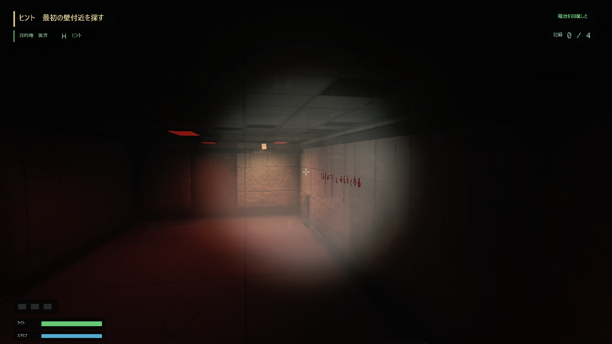<br>光の筋。半解像度で積分し、深度を見て拡大します | 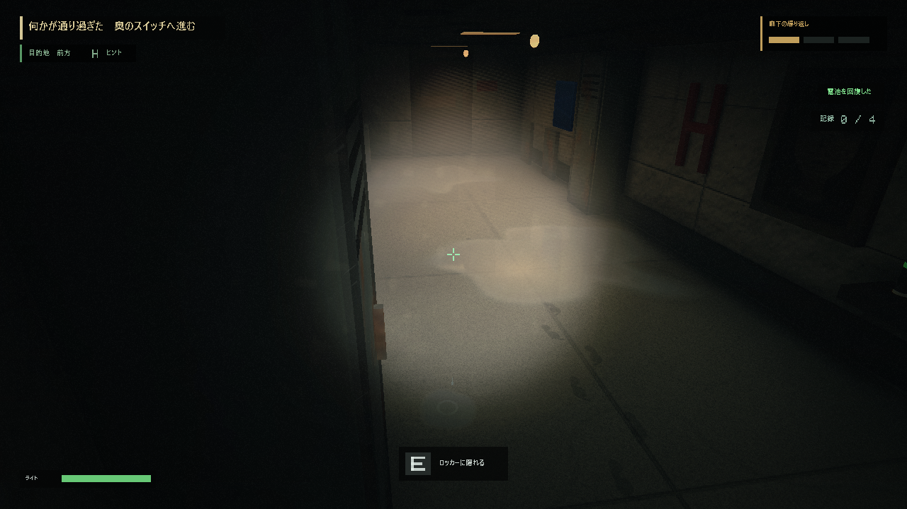<br>見えない影が水を踏んで残した裸足の跡。固定した異変と視点での撮影です |
| 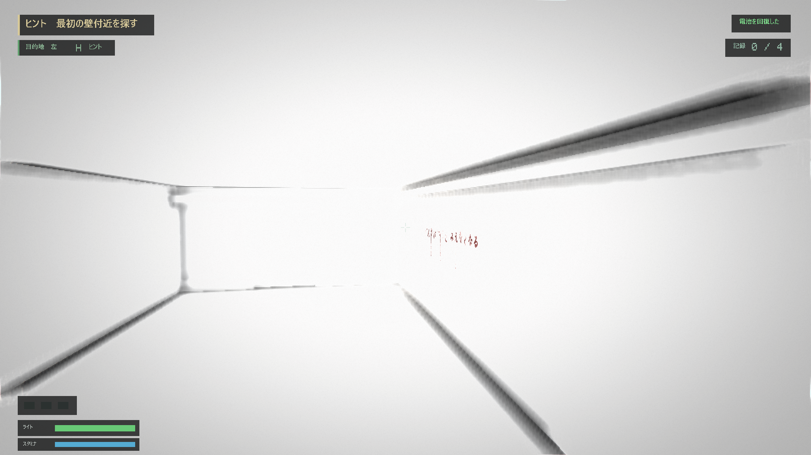<br>SSAOの確認表示。壁際の遮蔽を表示し、HUDや文字など別パスは残しています | 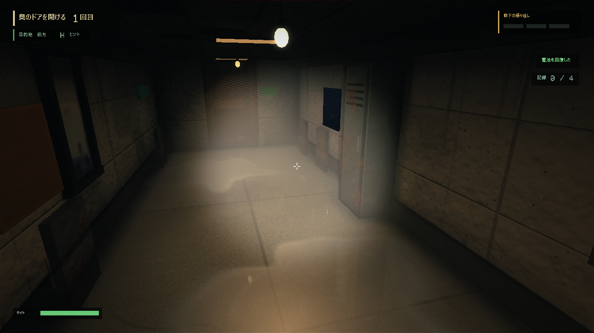<br>2面の揺れる裸電球。画質3では最寄りの電球から影を描きます |

[画質1〜3の計測表と条件](docs/QUALITY_BENCHMARK_20261031.md)、[画像の役割・元の撮影ファイル・ハッシュ](docs/images/capture_manifest_20261031.json)を記録しています。ファイル名から内容を推測せず、金属ポンプの材質と実画面を確認して画像を選びました。赤い塗装のバルブの近接画像は、錆の画像には使っていません。

再現用の撮影は `--capture-features <保存先> --effect-level 3` です。ドアの形を確認する部分だけFullbrightを使い、足跡は通常表示で撮ります。全編クリアの記録ではありません。

## Mayaで作ったモデル（11月1日）

これまでコードで箱や円柱を組んでいた物を、Maya 2025 のスクリプト（`mayapy` で実行）で作ったモデルに差し替えました。
スクリプトを実行し直せば、同じモデルを作り直せます。

- **一人称の手と懐中電灯**（`tools/maya/build_flashlight_hand.py`）：指・手のひら・親指をカプセルと楕円体の距離関数でなめらかにつなぎ（指どうしはつながない）、Surface Nets で面にしています。懐中電灯は断面を回した回転体です。頂点カラーに、指のすき間の暗がり・爪・血色・塗装のはげ・握りの溝の範囲を入れ、手元用のシェーダー（肌・布・金属）が使います。
  手は深度の範囲を手前に寄せて描くので壁にめり込まず、視点を回すと少し遅れて付いてきます。
- **人影・ロッカー・扉・配電盤・鍵・ヒューズ・電池・天井の照明・裸電球・排水バルブ**（`tools/maya/build_props.py`）：基本形を置いて角を面取りし、部位ごとにマテリアルを分けています。各頂点から光線を飛ばして求めた環境遮蔽を頂点カラーに焼き込んでいます。人影は手と同じ距離関数の作り方で、細長い手足と前へ傾いた頭にしました。
- **建物の配置のファイル**：1面の建物の壁と柱（`assets/layout/stage1_props.txt`）と、2面の廊下の壁・天井・縁取り・配管（`assets/layout/stage2_props.txt`）は、C++ ではなく配置ファイルに書いています。`room` を付けた壁が、部屋の角の暗がりとレイ反射の「部屋の形」になります。扉・天井の照明・電池・配電盤や端末・人影・壁の文字・暗証番号の手がかり・排水バルブ・ロッカー・裸電球・肖像画や時計・異変の印など、進行のコードが作る物の置き場所も、同じファイルの `place` 行（位置・向き・大きさ）から読んでいます（1面57・2面63）。ヒューズと鍵が落ちる場所の候補は `spot` 行で、プレイごとに組の中から1つを選びます。1面・2面とも、Debug 版ではゲームを動かしたまま F5 か、ファイルの書き換え（Unity から書き出したときなど）で読み直し、建物・小物と place 行の物を置き直します（プレイヤーの位置と、プレイごとに選んだ spot の場所はそのまま）。1面は配置エディターで壁も動かせます。
- **外の森**（`ForestScene`、`assets/layout/forest_props.txt`、`tools/maya/build_forest_props.py`）：ゲームの始まりに置く予定の、夜の森の場面。南の開始位置から、ゆるく蛇行する小道を北へ進むと、森の奥に3階建ての研究所（後ろに4階分の高さの階段の塔、屋上にアンテナと空調の機械。2階の窓が1つだけ明るい）がある。研究所の外壁は、外壁の材質（`shader/facadeSurface.hlsli`・`facadePS.hlsl`、11月10日）で描いている。長く放置された打ちっぱなしコンクリートとして、型枠のパネル（約0.9m×1.8m）の継ぎ目と板の木目の跡、Pコンの穴（型枠を留めた金物の跡。パネルごとに2列×3段）、窓の下の水切りと屋上の縁から垂れた黒い雨だれ（列ごとに幅・長さ・位置をばらつかせ、まだらに多い所と少ない所を作る）、継ぎ目からにじんだ白い白華、根元の泥はねと苔、ひびを、ワールド座標から色・粗さ・濡れ具合・凹凸として計算している。雨の濡れと壁を流れる水の筋（`forestWetness.hlsli`）も重ねている。配置ファイルの `prop` 行に `facade` を付けた箱が、この材質になる（`Wall::SetFacadeSurface`）。タイトルで1面（1つ目）を選ぶか、ゲームを `--forest` を付けて起動するか、Debug版のデバッグ画面（F1）の「外の森を開く」から開く。研究所の玄関を調べると、目的の画面を挟んで1面が始まる。
  - 枯れ木2種・倒木・岩・枯れた茂みは Maya のスクリプトで作った。木は当たり判定の箱を幹の大きさにし、枝は箱の外へ広げて作っているので、当たるのは幹だけ。
  - 研究所は、箱の壁・窓・扉・ひさし・灯り・アンテナの組み合わせで、全部が配置ファイルの行なので、Unity で窓1枚まで動かせる。灯り（玄関・小道の街灯・アンテナの先・2階の窓）は `glow` の付いた物で、その色で周りを照らす。地面は1面と同じ濡れた床で、水たまりに灯りが映る。
  - Unity のマップエディターの「Map Layout → 森を読み込む」で開いて書き出せ、Debug版で森を開いておけば、書き出した直後にゲームの森が置き直される。
  - `--capture <保存先> --forest` で、開始地点 → 街灯 → 研究所の正面を歩いて撮る。
  - 分かっている問題：遠くの地面が霧で灰色に明るくなり、黒い空との境目が横一直線に見える（屋内の1面・2面には空がないため、空と霧の色を森用に決めていない）
- **Unity のマップエディター**（`MapEditor/`、Unity 6000.3）：メニュー「Map Layout」の「1面を読み込む」「2面を読み込む」「森を読み込む」「3面を読み込む」で配置ファイルをシーンに並べ、動かしてから「配置ファイルへ書き出す」で書き戻します。Debug 版のゲームを動かしておけば、書き出した直後にゲームの中の配置が変わります。
  - 箱の壁・小物（prop）は配置ファイルの色の箱、扉・照明・電池などの置き場所（place）は紫の印と正面の向きの棒、ヒューズと鍵の候補（spot）は黄色の球です。位置・向き（y 軸の回転）・大きさを動かせます。
  - `model` の付いた小物（棚・机・警告灯など）と、種類の分かる置き場所（扉・照明・電池・配電盤・鍵・ヒューズ・人影・ロッカー・排水バルブ・裸電球・配管）は、ゲームと同じ FBX のモデルで、ゲームと同じ伸ばし方・回し方で表示します。モデルの表は Wall.cpp、物の種類は Stage1Layout.cpp・Stage2Layout.cpp、部位の色は各クラスの PropModel::Append の呼び出しから読み取るので、Unity 側に表を二重に持っていません。FBX はゲームの assets/model から写しています（Git には入れない）。
  - 書き出すときは、変わった数値だけを書き換え、コメント・空行・並びはそのまま残します。小物をコピー（Ctrl+D）すると、元の行のすぐ後ろに新しい名前の行が足されます。
  - シーンから消した物は、書き出すと配置ファイルからも行が消える（壁・小物などの prop 行と、ヒューズや鍵の候補の spot 行。spot は組の最後の1つだけは残す）。扉・照明・配電盤など、ゲームのコードが作る物（place 行）は、行が無いとゲームが止まるので消さずに残し、知らせを出す。読み込んだ後にゲームの配置エディターや手で足された行は、シーンにまだ無いだけなので消さない。
  - 名前が `ExtraLight_`（天井照明。停電中も赤い非常灯として点く）・`ExtraBattery_`（電池）で始まる place は、何個でも置ける物です。ゲームがその頭の名前の行をすべて作るので（`LayoutExtras`）、prop と同じようにコピーして足したり、消したりできます（どのステージでも使える）。11月13日に、1面でコードに位置が直接書かれていた天井照明18個を配置ファイルへ移しました（部屋の入口の4つは進む先の誘導で名前を使うので名前の決まった place、残りの14個は `ExtraLight_`）。Debug 版で配置を読み直すと位置・向き・大きさは置き直しますが、足した物・消した物はステージを始め直すと反映されます。
  - Unity もゲームも左手系・y が上なので、座標と向きはそのまま同じ値です。
  - バッチモードで、読み込んで何も変えずに書き出したファイルが元と1文字も違わないこと（1面・2面）と、動かした行だけが書き換わることを確かめています（`MapLayout.Editor.MapLayoutBatch.Check`）。
- **箱で置いていた小物**（`tools/maya/build_wall_props.py`）：1面の書類棚（ファイル・段ボール箱・紙の束が並ぶ）・机・木箱・崩れた資材・梁・キャビネット・配電箱・ポンプ・タンク・排水口・柱・天井沿いの配管・扉の上の表示灯・警告灯・安全地帯の電球とコード・卓上ライトと、2面のロッカーの本体・配管・扉の上の表示灯・鏡と肖像画と時計と偽の扉の額縁。当たり判定と水面に映す箱は箱のまま、見た目だけをモデルにしています。警告灯とライトは、レンズや電球だけが光り、金属の枠や笠は光りません。1面は配置ファイル（`assets/layout/stage1_props.txt`）の行に `model 名前` と書くだけで差し替えられ、モデルは置いた箱の大きさに合わせて伸びます。
- **距離場の人の形**（`tools/maya/build_figure_volumes.py`・`shader/figureVolume.hlsli`）：鏡に映る自分の体と、鏡・水たまり・西棟の水面にだけ映る人影は、物として置かずにシェーダーの中で描いています。以前はカプセルを並べた形でしたが、人影のモデルと同じ距離関数（自分の体は懐中電灯を前に持った立ち姿と部位の色）を3Dテクスチャ（0.4間隔、float16）に焼き、光線をその点の距離だけ進めるスフィアトレーシングで交差を求めるようにしました。自分の体は、股関節と肩のまわりに回した空間で距離場を読み、焼いた立ち姿のまま歩く手足の振りを付けています。法線は距離場の勾配から、人影の輪郭のぼけは光線が形に一番近づいた距離から求めています。計測モード（人影をカメラの前に置く `--figures`）では、カプセルのときとGPU合計の差は全地点で±0.05ms以内でした（鏡の前 3.87ms → 3.84ms）。
- **自分の体の影**：一人称なので体は描いていませんが、天井の照明や裸電球の下に立つと、床と壁に自分の影が落ちます。体を胴・頭・両脚・両腕のカプセルで表し、画素から光源への線分を遮るかを壁と床のシェーダーで調べています（見えない影の異変と同じ解析的な影）。歩くと影の脚と腕も振れます。

## 11月1日に足した、水面と影だけに現れるもの

| | |
|---|---|
| 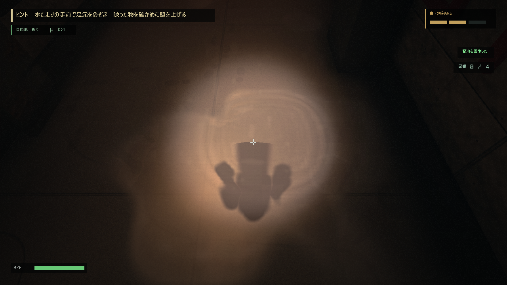<br>2面「水たまり」の異変。足元をのぞくと、水面にだけ逆さまの人影が映る（レイ反射の光線と人影の距離場） | 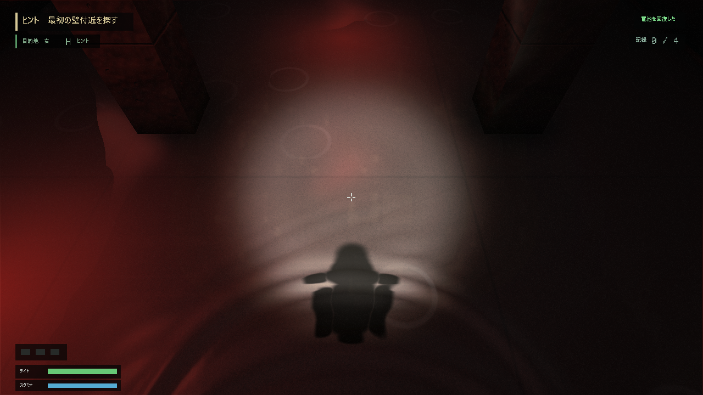<br>1面の西棟。水面にだけ、天井に張り付いた人影が映る。見上げると何もいない |
| 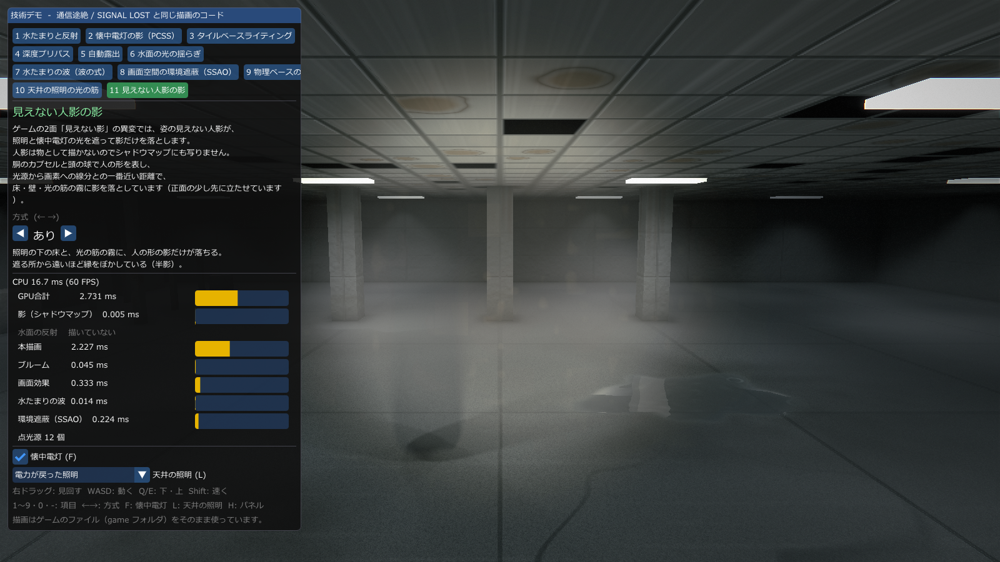<br>技術デモ：姿の見えない人影が、照明の光を遮って床と光の筋の霧に影だけを落とす | |

[画像の役割・元の撮影ファイル・ハッシュ](docs/images/capture_manifest_20261101.json)を記録しています。ゲームの2枚は `--capture`（通常表示、明るさ・色は未加工）、技術デモの1枚は `--screenshots` で撮りました。

改行・文字コードを確認するには `Job_application_work_horror/tools/check-text-format.ps1 -Path <ファイル>` を使います。読み取り専用で、コード名の画像データも中身から検出してエラーにし、書き換えません。vcxprojはCRLF、hlsl/hlsliはUTF-8 BOMなしを確認します。

## 森の草（2026年11月6日）

外の森の小道の両側に、風で揺れ、プレイヤーが近づくと倒れる草を加えました。木・岩・研究所の足元と小道の中央を避け、枯れた色とくすんだ緑を混ぜています。水たまりの水面（水たまりのメッシュと同じ楕円）と枯れた茂みの下にも生やしません。草の色は地面のテクスチャに近い明るさにし、根元の暗さは光にだけ掛けて、懐中電灯で照らしたときに黒い影に見えないようにしました（11月7日）。

CPUで根元・色・長さを決めた後、Compute Shaderが葉先の位置と速度を更新します。頂点シェーダーは3次ベジェ曲線から葉の帯を作り、頂点バッファを使わずインスタンス描画します。40単位の区画ごとに見える範囲を調べ、近くは5節、中距離は3節、遠くは三角形1枚へ減らします。本数も減らし、330〜410単位で地面へ縮めて消します（5節は140まで、3節は280まで。11月10日に、以前の110・220・260〜330から約1.25倍に広げました）。上限は30万本です。

起動は `--forest`、自動撮影は `--capture <保存先> --forest`。配置は `assets/layout/forest_props.txt` の `place ForestGrass` で範囲を指定します。Debug版で配置を読み直すと、木や岩の移動も反映して植え直します。F1で植えた本数・描画した本数・区画数を確認できます。

計測は `--benchmark <保存先> --forest`。起動時の環境変数 `SIGNAL_LOST_DISABLE_FOREST_GRASS=1` で草の計算・描画を止め、同じ3地点と比較できます。草の計算はGPU計測の「水たまりの波」に含まれ、草の描画は「本描画」に含まれます。草だけを単独計測する区間ではありません。草自身の影の生成と別視点への描画は今回の対象外です。

| 草あり | 草なし（比較用） |
|---|---|
| 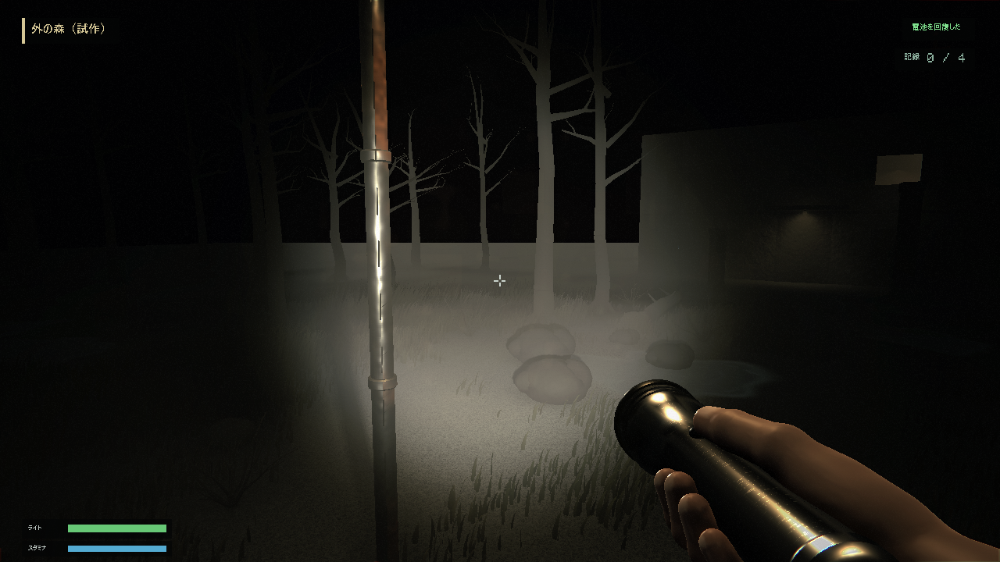 | 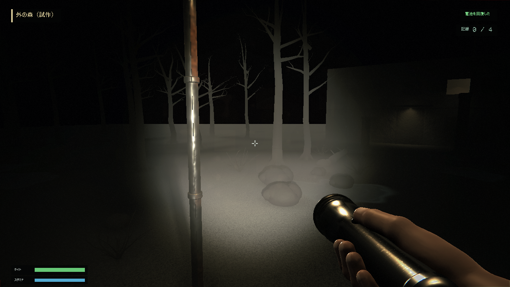 |

同じ地点・向き・ライトONの実機画像です（色と明るさは未加工）。264,868本を植え、この地点では24,106本・87区画を描いています。[計測値](docs/FOREST_GRASS_BENCHMARK_20261106.md)と[授業資料Part.9との対応](docs/FOREST_GRASS_PART9.md)を記録しました。

### 懐中電灯の光の広がり（2026年11月7日）

「暗い中でライトを使ったら、中心が明るいだけでなく、周りもぼんやり明るくなるはず」という意見から、本物の懐中電灯の光り方に近づけました。

- 翼の光（スピル）：明るい中心（ホットスポット）の外にも、中心の1〜2割の弱い光が約66度まで、なめらかに広がる（`flashlightLighting.hlsli` の `GetFlashlightSpillLight`。壁・小物・床・草・霧に共通）。懐中電灯は目のすぐそばにあるので、目に見えている面には懐中電灯からも光が届く。そのため翼の光には影もレンズの模様も付けず、計算は軽い。壁の文字は、これまでどおり中心の光でしか浮かばない（謎解きを簡単にしないため）。
- 照り返し：光が最初に当たった壁や床から少し手前に、弱い点光源を置き、跳ね返った光で部屋全体をぼんやり明るくしている（`Player::CollectPointLights`）。近い面ほど強く、位置と強さは少しずつ追いかけるので、急に跳ばない。

計測モードのGPU時間の増え方は0〜0.15msでした。

### 部屋の入口の目印の灯り（2026年11月7日）

初めて遊んだ人から「壁が見にくく、入口が分からず難しい」という意見があったため、1面の部屋の入口（壁の切れ目）11か所の横の壁に、暖かい白の小さな灯りを付けました（左右の倉庫、南西の広間、ループのドアの両側、書類保管室、暗証番号の扉、西棟の扉、ポンプ室、ループ廊下の曲がり角）。灯りは壁を通り抜けて両側を照らすので、暗い中でも遠くから入口の場所が分かり、入口の縁が光の中に浮かびます。矢印や文字では示さず、怖さを保ったまま視線を誘導しています。配置ファイル（`stage1_props.txt` の `DoorLamp`）に書いているので、Unity で位置や明るさを直せます。計測モードのGPU時間は、1面の地点で0.1〜0.5ms増えました（RTX 3050、最大でも7.2ms）。

### タイトル画面（2026年11月7日）

タイトルの後ろに、ゲームと同じ描画で外の森を映すようにしました（霧・草・水たまりの反射・懐中電灯・街灯のちらつき）。小道の入口 → 街灯と水たまり → 草むらを「見えない何か」が通る → 研究所の窓の明かりが消える、の4つの場面を、ゆっくり進むカメラで順に映し、場面が変わるたびに電波が途切れたようなノイズを入れています。題名「通信途絶」は、ノイズのときに横へずれ、赤と青緑に色がにじみ、横の帯が抜けます。画面全体にも監視映像の電波障害の横線と色ずれを重ね、右上の受信表示が「信号なし」に変わります。メニューは左側の暗い帯に縦に並べ、↑↓でも選べるようにしました。

| 森を映すタイトル | 場面が変わるときのノイズ |
|---|---|
| 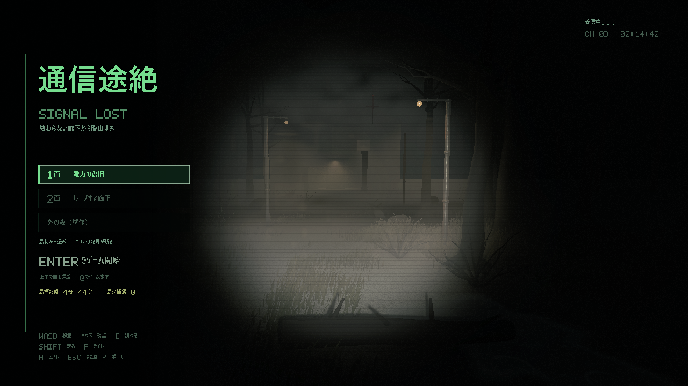 | 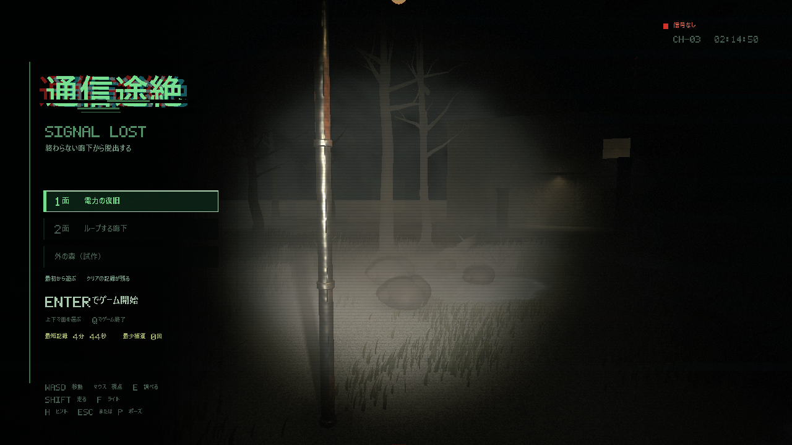 |

### 森を歩いて研究所に入る（2026年11月9日）

タイトルで1面を選ぶと、夜の森の南の小道から始まり、森を歩いて研究所に入ってから1面が始まるようにしました。歩いている間に、研究棟からの無線（導入と同じ受信記録の4行）が、画面の下に字幕で1行ずつ届きます。行が届く瞬間に画面が乱れ、無線の雑音が鳴ります。研究所が見えてくる所（2階の窓の明かりが消える辺り）で「通信途絶」になり、目的の表示が「研究所の玄関を調べて、中に入る」に変わります。玄関を調べると、扉の音がして暗転し、そのまま黒い背景に目的と操作が出ます。開始を選ぶと1面に入ります。前の導入（受信記録から全部見せる）は、タイトルの3つ目「1面  森を飛ばして始める」で遊べます。

| 歩きながら届く無線 | 研究所の前で通信途絶 |
|---|---|
| 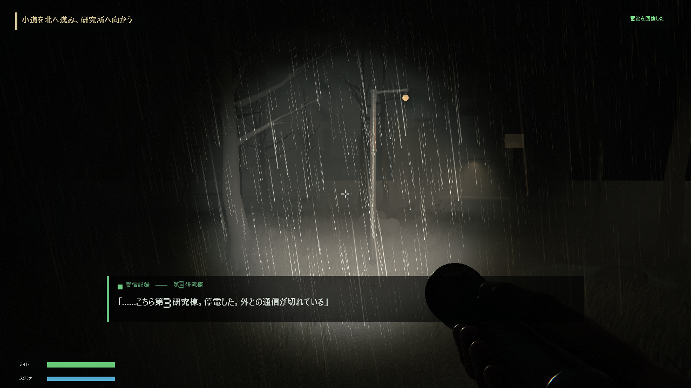 | 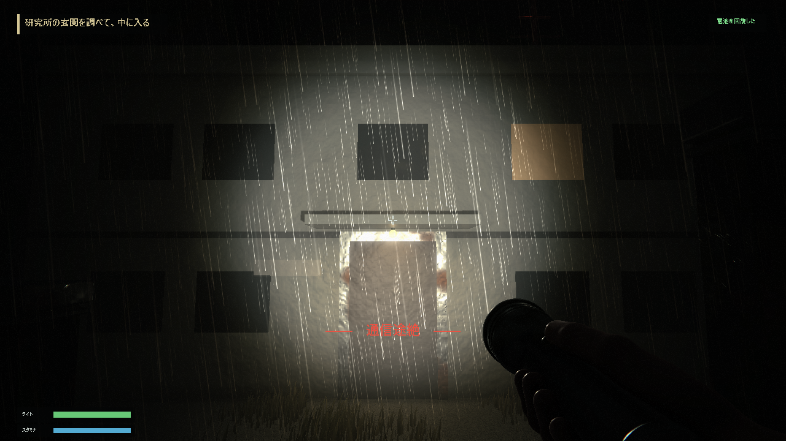 |

小道から研究所へ視線を向けると、一度だけ青白い稲光が外壁と屋根を照らし、建物の輪郭が浮かびます。

### 森の雨（2026年11月9日）

11月10日に、以前より弱い雨にして戻しました。強さは `ForestScene.h` の `RainStrength`（今は0.35。1が下の画像の強い雨）で、雨粒としぶきの数（強さの割合だけ描く）・落ちる速さと筋の長さ（弱いほど少しゆっくり短く）・水たまりの雨の輪・雨音の大きさがまとめて変わります。1粒ずつを薄くするだけだと、強い雨が遠くにかすんで見えるので、主に粒の数を減らしています。水たまりの雨の輪も、1つずつの強さは変えずに数だけを減らし、波を計算している範囲（プレイヤーのまわりの一辺192）の全体に落とすようにしました（以前はまわり48までで、少し離れた水たまりには輪が出ていなかった）。

11月13日に、森だけ波を計算する範囲を一辺192から576（768x768マス。マス目の大きさ0.75は同じ）に広げました。森は1メートル≒24の大きさで作っているので、一辺192は約8メートル四方しかなく、少し離れた水たまりには、雨粒が落ちても波が計算されていませんでした（波の高さと範囲を色で塗って撮影し、範囲がカメラのすぐ前だけだったことを確かめた）。あわせて、カメラから離れた雨粒ほど輪を大きく強くし（距離240より遠くで半径2.4倍・強さ3倍）、床のシェーダーでも離れた輪ほど光り方を強めて（最大2.5倍）、遠くでも輪が1画素より細くならないようにしています。マス目の数はテクスチャの大きさから読むので、1面・2面は今までどおり256x256です。計測モード（RTX 3050 Laptop、1920x1080）で、森の「水たまりの波」（草の計算を含む）は0.18msから0.29msになり、ほかの段階は測るたびの揺れの中で同じでした。

あわせて、水たまりを踏んだときに画面（レンズ）に付く水滴を作り直しました（森と研究所の中の両方）。以前は歩いて踏むだけで、毎回同じ5か所に白い輪のような粒が出て、約100秒かけてゆっくり流れていました。今は、走って水を強く蹴ったときだけ、画面の下の方の毎回違う位置に小さなしぶきが付きます。粒は小さな凸レンズのように後ろの景色を小さく逆さに映し、縁は水の厚みで暗い細い線、光る所は左上の小さな点だけです。大きい粒ほど重く、縦に伸びながら流れ落ち、約2.6秒で乾きます（`shader/crtOverlayPS.hlsl`）。`RainEnabled` を `false` にすると、雨のない夜の森になります。

外の森（タイトルの後ろ・導入・外の森の場面）に雨を降らせました。雨粒（24,000本）と地面のしぶき（900個）は、頂点バッファを使わず、頂点シェーダーが番号から位置を作っています。乱数の位置を「落ちる速さ × 時間」だけずらし、カメラを囲む箱の中で折り返すので、CPU は毎フレーム時間とカメラの位置を送るだけです。雨粒は自分では光らず、懐中電灯（影つき）・街灯・窓の明かりを受けたときだけ光ります。夜の雨が、ライトの光の中だけで白く浮かぶようにしました。灯りの手前を落ちる雨は、光が前へ散ってより明るく見えます。遠くの筋が1画素より細くなってちらつかないよう、幅を1画素まで広げて、その分だけ薄くしています。研究所の屋根と玄関のひさしの下には降りません。水たまりに落ちた雨は、水たまりの波のシミュレーション（波の式の Compute Shader）へ「おもり」として渡しているので、輪が重なって干渉し、岸で跳ね返ります。雨音（`tools/generate-rain.ps1` で合成）もループさせています。計測モードの本描画のGPU時間は、森の3地点で約0.1ms増えました（RTX 3050、1920x1080。起動前に `SIGNAL_LOST_DISABLE_FOREST_RAIN=1` で雨を止めて比べられます）。

| 街灯と懐中電灯の光の中の雨 | 地面のしぶきと水たまりの輪 |
|---|---|
| 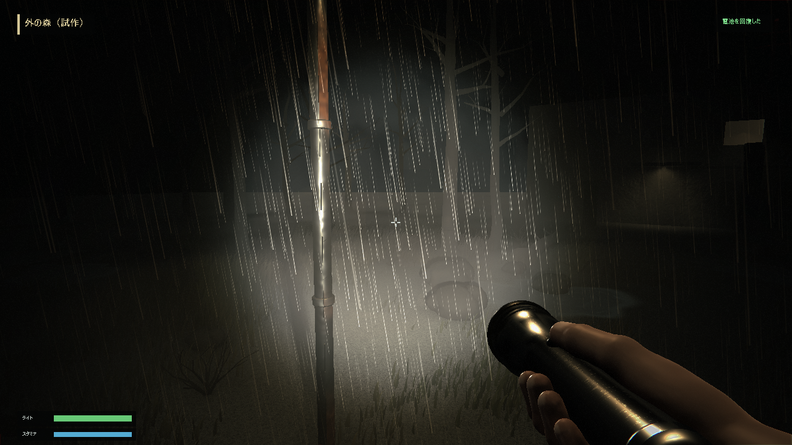 | 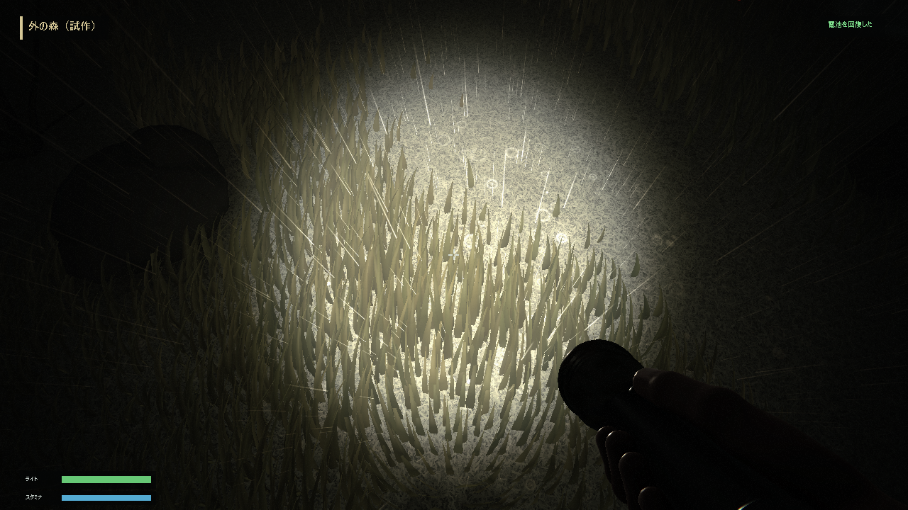 |

### 1面の前の導入（2026年11月9日）

初めて遊んだ人が「何をするゲームか」をすぐ分かるように、1面の前に導入（`IntroScene`）を挟むようにしました（同じ日に、森を歩いて研究所に入る流れに変えたので、今はタイトルの3つ目「森を飛ばして始める」で見られます）。後ろはタイトルと同じ森で、研究所の正面へゆっくり近づくカメラ（途中で2階の窓の明かりが消える）を映しています。研究棟からの受信記録が4行、無線の雑音と電波の乱れの中で1文字ずつ届き、「通信途絶」で途切れます。そのあと、目的（ヒューズを3本集めて配電盤に戻し、電力を復旧して脱出する）と基本の操作（ライト・調べる・ヒント）を見せます。Enter で受信記録を飛ばせます。

| 受信記録 | 目的と操作 |
|---|---|
| 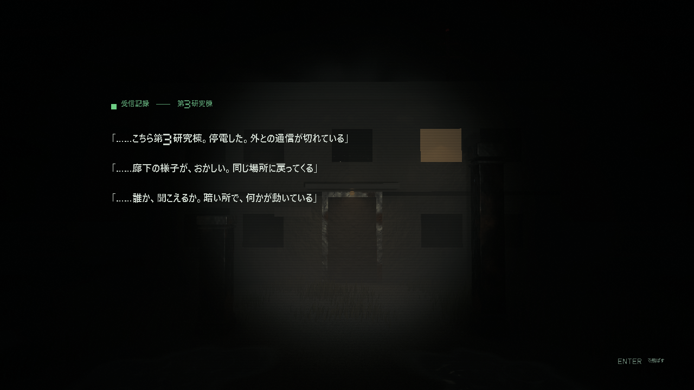 | 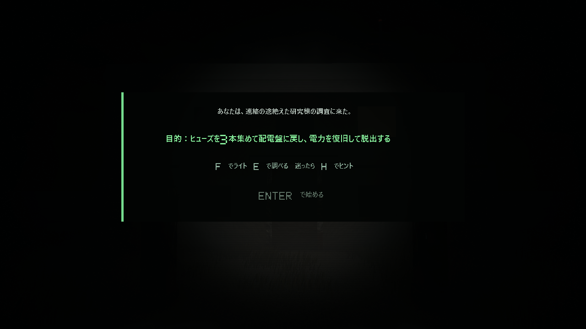 |

### 森の入口の演出（2026年11月7日）

外の森の小道から研究所の入口までに、灯りの小さな演出を3つ足しました（`ForestEvents`）。

- 小道の街灯：近づくほど、ときどき途切れるように明滅します。小道を北へ進んで街灯を通り過ぎると、後ろの街灯が「カチッ」という音とともに1つずつ消えます（振り返ると、来た道が暗くなっています）。
- 研究所の2階の窓：研究所が見えてくる所まで来ると、ただ1つ明かりのついていた窓がまたたいて消えます（中の誰かが明かりを消したように見せています）。その瞬間、恐怖で視界が狭まる画面効果を短く出します。
- 研究所の玄関の灯り：正面まで来ると、不安定に明滅し始めます。
- 草むらを通る「見えない何か」：街灯を過ぎて小道を少し進むと、前方の草むらを、姿の見えない何かが左から右へ横切ります。低くした重い足音がその足元から動いていき、足元の草だけが押し倒されます。押し倒された葉は、倒れ具合と倒れる向きを葉ごとに覚えていて（草の Compute Shader の状態バッファの空いていた値）、約5秒かけて起き上がるので、通った跡が草むらにしばらく残ります。横切っている間は、恐怖で視界が狭まる画面効果を弱く出します。

灯りの明るさは、光る色と照らす点光源の強さにまとめて掛ける倍率（`Wall::SetEmissionScale`）で変えています。灯りは配置ファイルの名前で探すので、Unity で街灯や窓を動かしても演出はそのまま付いてきます。自動撮影の森の道順に、街灯を通り過ぎて振り返る1枚（`forest_02b_振り返ると街灯が消えている`）と、草むらを何かが横切る2枚（`forest_02c_草むらを何かが通る`・`forest_02d_通った跡が草むらに残る`）を足しました。

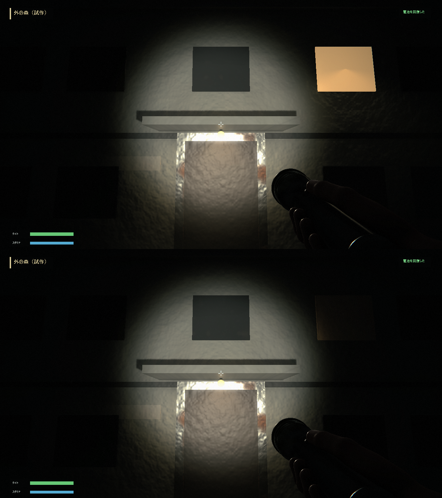

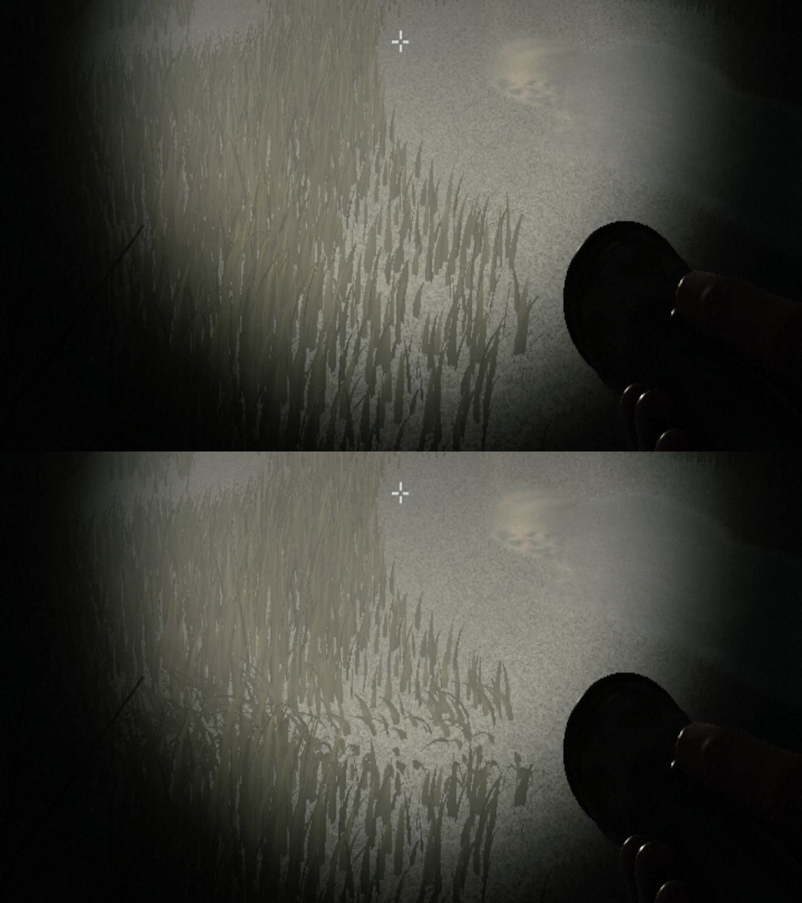

### 草のLODとカメラの上方向への曲げ（2026年11月7日）

外の森の草は、ゲーム本体ではLODを有効にして描画します。計測モードの森の3地点（RTX 3050、ライトON）では、LODありの本描画が LODなしより0.08〜0.23ms短くなりました（2.40〜2.80ms と 2.48〜2.98ms。遠くの草は闇と霧でほとんど見えないため、差は大きくありません）。「草をカメラの上方向へ曲げる」は授業資料 p.23 の工夫で、見下ろすほど葉先をカメラの上の向きへ倒し、葉の面を見せます。真上近くから見たとき、草が細い線や点に見えて地面が透ける破綻を軽くします。自動撮影の森の道順に、草むらを見下ろす5枚目（`forest_05_草むらを見下ろす`）を足しました。

| 上：曲げなし ／ 下：曲げあり（草むらを見下ろす） | LODを色で表示（開始地点） |
|---|---|
| 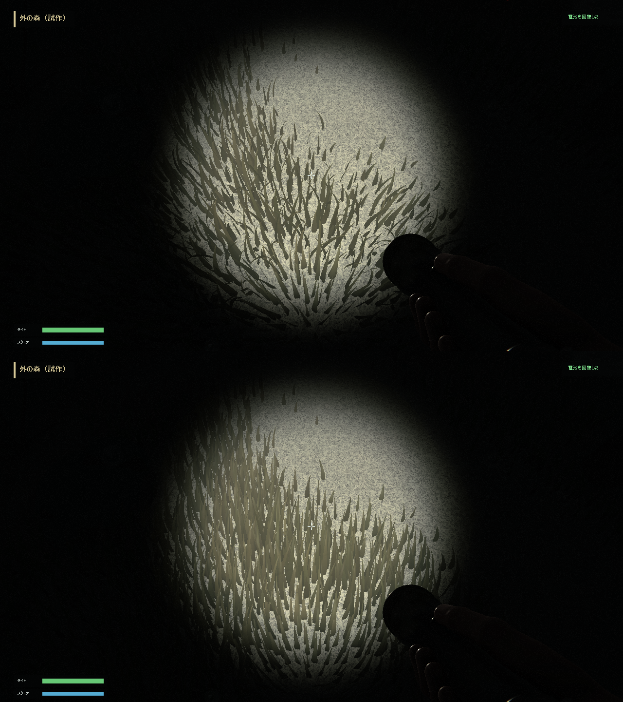 | 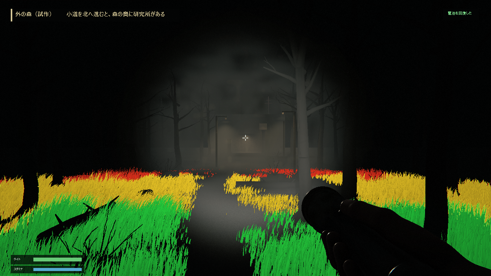 |

### 森の空の霧と地平線（2026年11月7日）

霧（床の近くの霧と、全体に漂う薄い霧）は、面を描くシェーダーが目からその面までの視線に沿って足しています。空には面がないため霧が足されず、遠くの地面の霧と黒い空の境目が、地平線のような1本の線に見えていました。`SkyBackdrop` が、空の画素を「描画の奥の端（1000）にある黒い面」とみなし、地面と同じ式で霧と色調を重ねます。画面全体を三角形1枚で覆い、深度1.0・深度の書き込みなしで描くので、手前に描かれた物は上書きしません。懐中電灯の円錐の中では霧が空へ続いて遠くの木が霧に溶け、円錐の外の境目の明るさの差も0〜255のうち約4に減りました。森では右上の「記録 0 / 4」も出さないようにしました（森には記録を置いていないため）。
