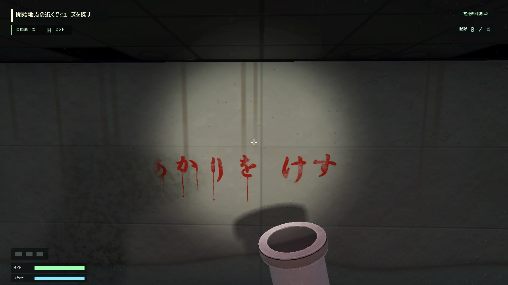
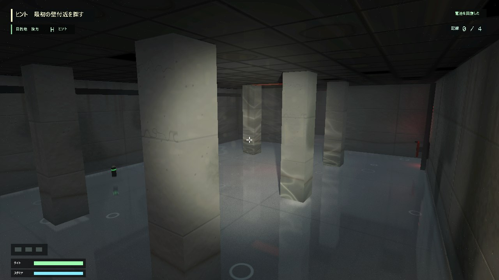
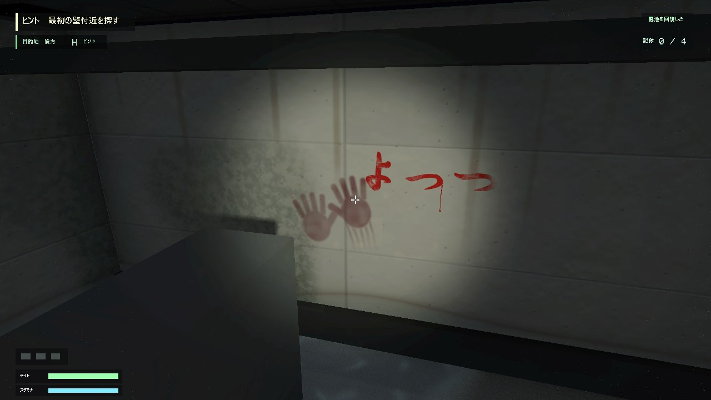
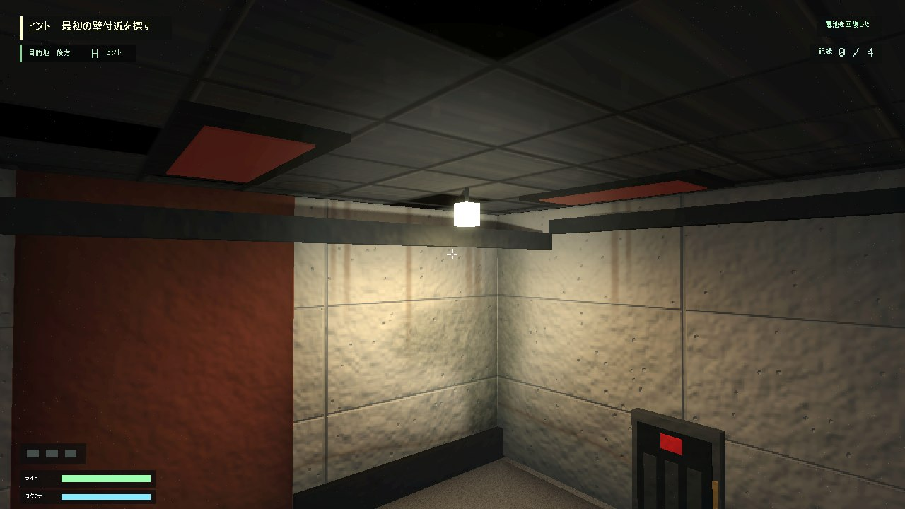
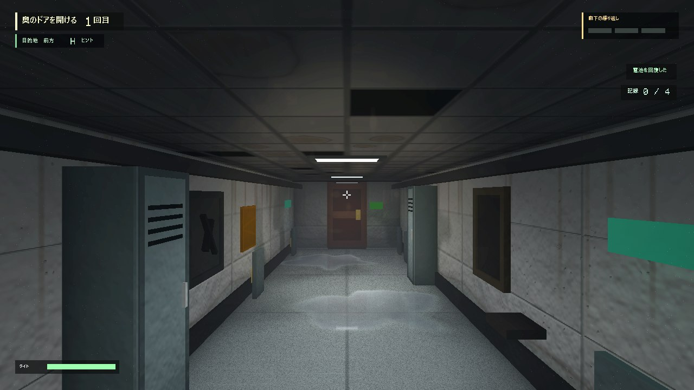
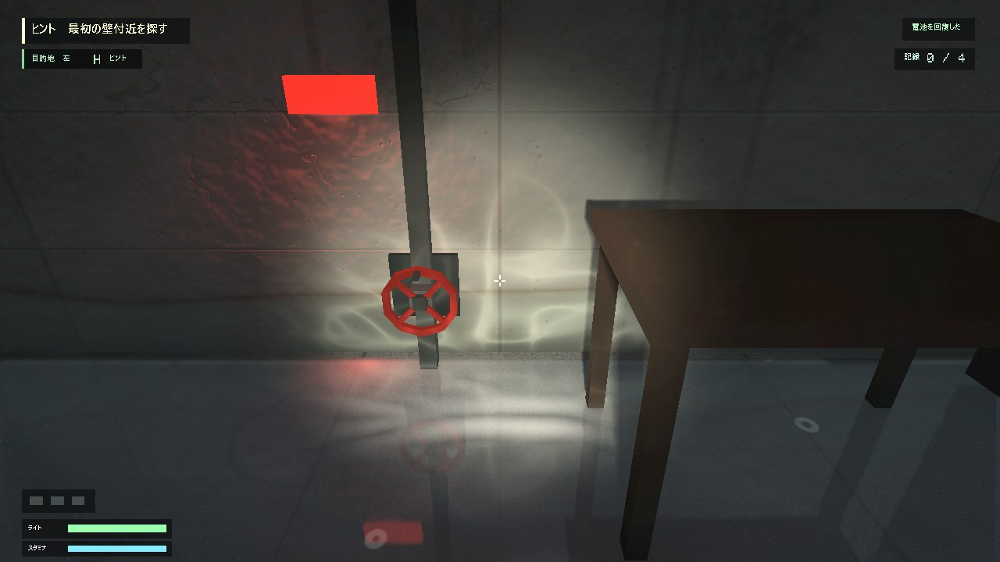
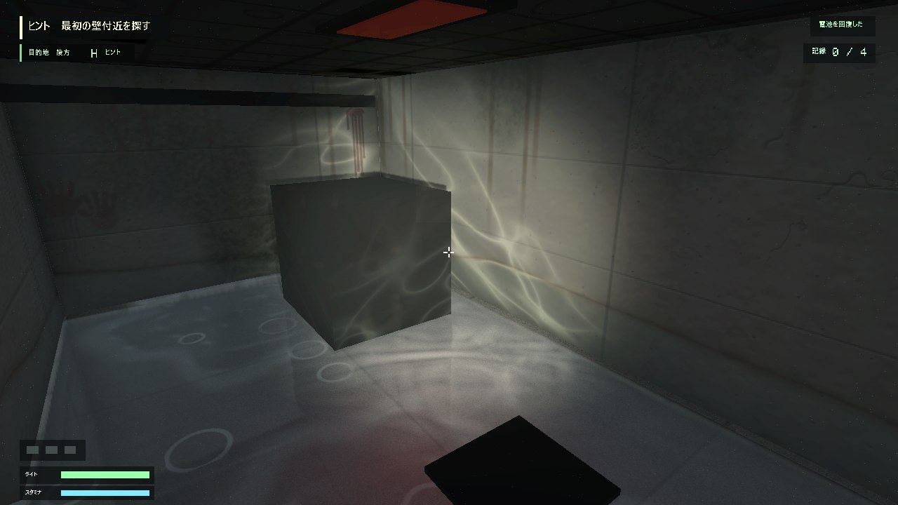
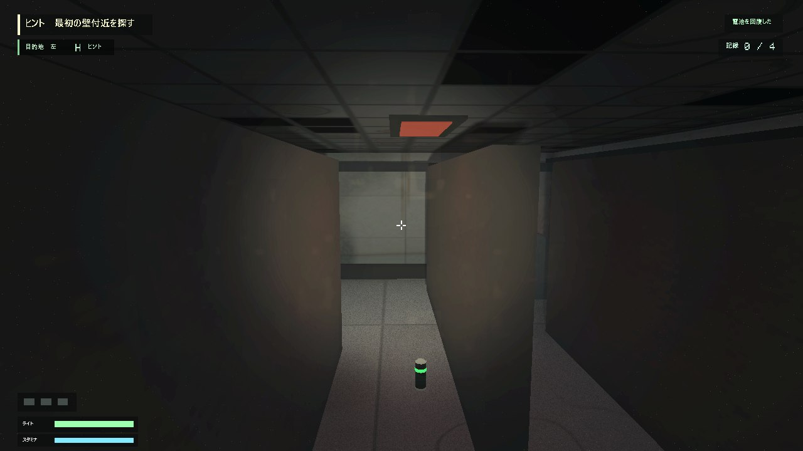

# 通信途絶

C++ / DirectX 11 / HLSLで制作した、一人称視点の短編ホラーゲームです。
暗い施設を探索して電力を復旧し、異変が繰り返される廊下からの脱出を目指します。

## ゲームの画面

資料用に明るくしています（`tools/make-readme-images.ps1`）。実際のゲームはもっと暗く、懐中電灯で照らした所だけが見えます。

| | |
|---|---|
| <br>懐中電灯で照らした所だけに浮かぶ壁の文字 | <br>床一面が水に浸かった西棟。排水バルブで水を抜く |
| <br>照らすと赤黒く浮かぶ血の手形と、引きずった跡 | <br>停電しても消えない暖かい電球の下（光の安全地帯） |
| <br>2面：同じ廊下を繰り返し、異変を見つける | |

## ホラーのための描画（見てほしい順）

1. **懐中電灯で照らした所だけが見える**：壁の文字、血の手形・引っかき傷・垂れ跡（`horrorMarks.hlsli`）、手元から作る影をPCSSで柔らかくした影。
   画像素材を使わず、ワールド座標と距離の式で描いている。
2. **水**：水たまりの反射（平面反射。キューブマップ・SSRと切り替えて比べられる）と、足音・水滴で立つ波（Compute Shaderの2次元の波動方程式。GPU時間は約0.012ms）。
   波の斜面が懐中電灯の光を返し、波が集めた光が壁に輪になって映る。
3. **光で導き、休ませる**：次に進む方向の電気だけが切れかけの電球のように不規則にちかちかする（矢印ではなく光で誘う）。暖かい電球の下は心拍と物音が静まる安全地帯。
4. **重さを抑える仕組み**：タイルベースライティング（光源200個で本描画が約6倍軽い）、深度プリパス、画面に映る時だけ反射を描く。
   どれも、ゲームの中の技術デモ（F2）と、別リポジトリの技術デモ（GraphicsTechDemo）で、方式を切り替えて見た目とGPU時間を比べられる。

| | |
|---|---|
| <br>歩いた跡の波が集めた懐中電灯の光が、壁に輪になって映る | <br>懐中電灯の中で光る波の輪と、浸水した西棟の水面の光の揺らぎ |
| <br>書類保管室の棚の影（手元から作り、PCSSで柔らかくする） | |

詳しい一覧は「技術的な見どころ」、試してうまくいかなかったことと直し方は「試したことと直したこと（経緯）」にまとめています。

## 作品概要

- ジャンル：一人称探索ホラー
- 対応環境：Windows x64
- ステージ数：2
- 開発言語：C++20、HLSL
- 描画API：DirectX 11
- デバッグUI：Dear ImGui（Debug構成）

### 1面

施設内を探索して3個のヒューズを回収し、分電盤へ戻して電力を復旧します。
照明、濡れた床、水たまりの反射、影の出現などを使って探索中の緊張感を作っています。
ヒューズが部屋のどこに落ちているかはプレイごとに変わり、毎回ライトで部屋を探します。
目的地の矢印とは別に、次に進む方向の天井の電気が1つだけ、切れかけの電球のように不規則にちかちかします（ほかの照明は落ち着いて点いたまま、明るさや色は同じ）。その電気の下まで歩くと、その先の電気がちかちかし始めます。
暗く冷たい施設の中に、停電しても消えない**暖かい色の電球（光の安全地帯）**が2か所あります（中央ホールの配電盤のそば、南西の広間の机）。灯りの下では心拍が静まり、姿の見えない物音が止み、画面のざらつきが和らぎます。ライトを消して休むと、電池が半分を少し超えるまで少しずつ戻ります。暗い所へ出ていく前の、緊張と緩和の「緩和」です。
長く放置された施設として、壁には打ちっぱなしコンクリートの継ぎ目・気泡の穴・ひび・上から垂れた錆の跡・床際の水位線・カビが、床には目地・染み・引きずった跡・壁際の埃が、天井には外れ落ちた天井板や雨漏りの染みがあり、部屋の隅ほど暗くなります（画像素材を使わずシェーダーで計算）。
3本目のヒューズは、西側の壁の扉の先にある**西棟（浸水した機械室）**の一番奥にあります。右の倉庫で西棟の鍵を拾って扉を開けると、床一面が水に浸かった、柱の並ぶ広い部屋に出ます（技術デモと同じ部屋の作り）。
ヒューズは水の底に沈んでいて、そのままでは見つかりません。赤いランプの下にある3つの**排水バルブ**を、Eキーを押し続けて回します。1つ回すごとにランプが緑に変わり、水が奥のポンプ室の排水口へ向かって引いていきます（床の水に浸かった範囲を少しずつ縮め、反射・波紋・足音・水面の光の揺らぎがそれに合わせて消える）。3つとも回して水が引くと、ポンプ室でヒューズが見つかります。
バルブを回している間は手が離せず、回し終えるたびに背後で何かが水の中を歩きます。西棟に影は出ません。水の滴る音、背後で水の中を歩く音、ヒューズを取った瞬間に入口の扉が閉まる音など、音と暗さだけで怖がらせます。
左の倉庫の南の入口の先には、寄り道の**南西の広間**があります。柱が並ぶ暗い広間で、赤・緑・青・橙の警告灯が自分の色で周りを照らし、奥の棚と机の一角では懐中電灯の影が、根元はくっきり、離れた棚ではぼんやり落ちます（技術デモと同じ部屋の作り）。奥には電池が落ちています。
廊下の西側の書類保管室は、目線より高い棚が並ぶ迷路になっています。部屋に入ると「照らすと止まる影」が現れ、懐中電灯で照らしている間は動きませんが、光を外すと棚の間を回り込んで近づいてきます（格子の幅優先探索による経路探索）。触れられると電池を奪われるため、電池を使って照らし続けるか、目を離して迷路を進むかの駆け引きになります。

### 2面

同じ廊下を繰り返しながら変化を見つける、ループ型のステージです。
壁・天井・床は1面と同じ描画（古さ、角の暗がり、濡れた床と水たまりの反射・波）で描いています。
偽ドア、時計、肖像、傷跡、足音による危険度、信号盤パズル、追跡イベントを段階的に進めます。
1周目・2周目に見つける異変（偽ドア・時計・肖像画・壁の向こうのノック・血の手形）はプレイごとにランダムに変わり、それぞれ解き方が違います。血の手形は、壁に浮かんだ手形を懐中電灯で照らすと、奥の反対側の壁に次の手形が現れ、4つ目までたどると見つけたことになります（1面の壁の血の跡と同じ形の式で、壁のシェーダーに描いている）。
ノックは立体音響だけを頼りに、音の出どころの壁を探します。
廊下には隠れられるロッカーがあり、足音を聞いて追ってくる影から隠れてやり過ごせます（近づかれてから隠れると見つかります）。
危険が迫ると自分の心拍と呼吸が速く大きくなり（隠れている間は息を殺し、心拍だけがはっきり聞こえます）、コントローラーも心拍に合わせて震えます（1面でも、影が近いときや隠し部屋に閉じ込められている間に聞こえます）。

クリア後のリザルト画面では、評価に加えて「今回の発見」（読んだ壁の文字の数、隠し部屋から脱出したか、2階で出た異変）を表示します。

## 操作方法

| 操作 | キーボード・マウス | XInputコントローラー |
|---|---|---|
| 移動 | `W` `A` `S` `D` | 左スティック |
| 視点操作 | マウス | 右スティック |
| 調べる・操作する（西棟のバルブは押し続ける） | `E` | A |
| 懐中電灯 | `F` | Y |
| 走る（2面は最後の追跡のみ） | `Shift` | 左スティック押し込み |
| 目的ヒント | `H` | LB |
| ポーズ | `Esc` または `P` | START |
| タイトル開始 | `Enter` | A または START |
| タイトル終了 | `Q` | B |

ポーズ画面の「目的表示」を「なし」にすると、目的の文章と目的地の矢印を出さない、説明のない遊び方になります。

ポーズ画面の「描画解像度」で、画面より小さい解像度で描いて軽くできます（自動 / 100% / 75% / 67%、次回起動から反映）。
「自動」は、単体GPUなら100%、内蔵GPUなら67%で描きます（HUDが収まるよう、縦720より小さくはしません）。
画面の拡大率（125%など）にも対応しており、モニター本来の解像度で描画します。
HUDは縦864の画面を基準に配置し、描画解像度に合わせて拡大縮小するため、画面の大きさや描画解像度によらず同じ比率で表示されます。

Debug構成では `F1` でImGuiデバッグ画面を表示できます。
1面の小物（棚・配管・木箱・警告灯など約60個）の配置は `assets/layout/stage1_props.txt` に書いてあり、Debug構成ではゲームを動かしたまま `F5` で読み直せます（書き間違いは行番号付きで画面に出し、前の配置のまま続けます）。
`F1` のデバッグ画面には配置エディタ（Prop Layout Editor）があり、景色の中の小物をクリックして選び、位置・大きさ・色・当たり判定・影・光を見ながら変えて、`Save to file` でこのファイルへ書き戻せます（変えた行だけを書き換え、コメントや並びは残します）。

## ビルド方法

1. `Job_application_work_horror.slnx` をVisual Studioで開きます。
2. 構成を `Release`、プラットフォームを `x64` にします。
3. 「ソリューションのビルド」を実行します。

プロジェクト設定はC++20、Platform Toolset `v143`、Windows SDK `10.0.26100.0`です。
`external` 以下にDear ImGuiなど必要なサードパーティーファイルを同梱しています。

- Assimp 5.2.5：`external/assimp` にヘッダー、Debug/Release用のlibとDLLを同梱しています。
  公式ソースを `v143`・静的CRT（`USE_STATIC_CRT=ON`）でビルドしたもので、VC++ランタイムのインストールは不要です。
  DLLはビルド後に実行ファイルと同じフォルダへ自動でコピーされます。
- DirectXTK：使用しているのは `SimpleMath` のみのため、ヘッダーと、SimpleMath部分だけを取り出した小さなlib（Debug/Release、静的CRT）を
  `external/directxtk` に同梱しています。追加のインストールは不要です（詳細は `external/directxtk/README.md`）。

## 技術的な見どころ

- HLSLによる懐中電灯、濡れ床、ブルーム、ビネット、フィルムグレインなどの画面表現
- Compute Shaderによるタイルベースライティング（画面を16x16のタイルに分け、タイルごとに影響する点光源だけを計算。光源数の上限を8個から256個へ拡張。深度プリパスの深度からタイルの一番奥の深度を求め、壁の向こうの光源も外す）
- 深度プリパス（Zプリパス）。不透明な壁・床・扉の深度だけを本描画と同じ頂点シェーダーで先に描き、隠れた画素の重いピクセルシェーダーを省く。本描画のGPU時間が2.3〜4.8msから1.3〜1.5msに減った（RTX 3050 Laptop、1920x1080。導入前後の画面を画素単位で比べて見た目が変わらないことを確認）
- Compute Shaderによる自動露出。画面の明るさの対数平均（中央を重く）を1グループ256スレッドで求め、暗い所へはゆっくり・明るい所へは素早く目が慣れる。結果はGPUのバッファに置いたまま露出のシェーダーが読み、CPUへ読み戻さない
- X3DAudioによる立体音響（背後から近づく人影の足音、扉・配電盤の音を実際の位置から再生。壁や閉じた扉の向こうの音はローパスフィルターでこもらせる）
- 1面の姿の見えない物音（天井裏を歩く足音・配管を叩く音・遠くの扉のきしみ）を、プレイヤーが見ていない方向からランダムに再生。台本の演出中は鳴らさない。配管の音は `tools/generate-pipe-knock.ps1` で合成した自作の効果音
- 1面の壁の文字は、懐中電灯の光が当たった部分だけに浮かび上がる（壁と同じ配光・距離減衰・シャドウマップで表示量を計算する専用ピクセルシェーダー）。ループ廊下の文字は目を離した隙に書き換わる。文字の画像は `tools/generate-wall-writings.ps1` で生成
- 建物の壁の「古さ」（1面と2面。`litTexturePS.hlsl` の `GetWallAgeing`）。天井（下向きの面）は天井板・外れた板の穴・雨漏りの染み、床（`wetFloorPS.hlsl` の `GetFloorAgeing`）は目地・ひび・染み・引きずった跡・壁際の埃を同じ方法で描く。高さから法線を作る処理は `surfaceDetail.hlsli` で共通化。コンクリートの継ぎ目・気泡の穴・ひびを凹凸（画面上の偏微分から法線を作るバンプ）として、錆の垂れ跡・水位線・カビを色として、ワールド座標から計算する。遠くで1画素より小さくなる模様は`fwidth`で薄め、描かない面では分岐で計算を省く。古さの濃さは面ごと（`Renderer::SetWallWeathering`、1面は1・2面は0.85）、描く面は材質の印（`Wall::SetWeatheringSurface`、建物の壁と天井だけ）で決める。血の手形・引っかき傷などの決まった跡は、2面では異変と紛れないよう描かない（`SetWallWeathering` の2つ目の値）
- 1面の部屋の角の暗がり（`shader/roomOcclusion.hlsli`）。画面の深度から推定するSSAOではなく、建物の壁を上から見た長方形（最大32個）と床・天井の高さを定数バッファで渡し、壁までの距離から床際・天井際・壁と壁の角の暗さを直接計算する（ノイズや画面端のちらつきが出ない）。環境光と天井灯には全部、懐中電灯には4割だけ掛ける
- 1面の壁のホラーらしい跡（`shader/horrorMarks.hlsli`）。血の手形と下へ引きずった跡、4本の引っかき傷、上から垂れて先に雫がたまった血を、線分と楕円の距離関数で画像素材を使わずに描く。壁に沿って幅70ごとに区切ったマスの4割弱にだけ置き、マスの乱数に壁の面の位置も混ぜて、平行な別の壁に同じ跡が並ばないようにしている。暗い施設では懐中電灯で照らした所だけが見えるので、照らすと赤黒い跡が浮かび、血は濡れて浅い角度で光を返す
- 1面の暗証番号の扉（任意探索）。4桁の番号はプレイごとにランダムに決まり、施設の壁に懐中電灯でしか見えない文字で書かれている。扉の先は入れなかった部屋で、入ると閉じ込められる。暗闇で鍵を探し、近づいてくる影はライトで追い払う
- Planar Reflectionによる水たまりの反射。浮いた埃や油膜を表すノイズで水面の荒さを場所ごとに変え、荒い所ほど反射を縦に伸ばしてぼかす（濡れた床に映る照明が縦に伸びて見える現象）
- 水たまりの反射の方式の比較（ゲームの中の技術デモ F2 と、別リポジトリの技術デモで切り替える）。平面反射（正確・反射の段階0.28ms）、キューブマップ（`ReflectionProbe`。カメラの位置から6方向を撮り、1フレームに1面ずつ撮り直す。0.03msと軽いが、近くの物は映る位置がずれる）、SSR（`ScreenSpaceReflection`。深度プリパスの深度を写し取り、床のシェーダーで反射の光線を画面の深度に沿ってたどり、前のフレームの画面から色を読む。景色を描き直さないが、画面に映っていない物は映らない）。ゲームの普段の方式は平面反射
- 1面の西棟の水面の光の揺らぎ（コースティクス）。壁や天井の点を水面で折り返した点へ懐中電灯の光が向かっているかを配光の式で求め、光が水面に当たる点に流れる網目の模様を掛ける
- Compute Shaderによる水たまりの波のシミュレーション（2次元の波動方程式）。プレイヤーのまわりの一辺192を256x256マスに分け、2枚のテクスチャを交互に読み書きして1秒に60歩ずつ進める。足音と水滴がおもりになって輪が広がり、輪どうしが重なって干渉し、水たまりの岸（乾いた床は高さ0）と、床に立った柱・棚・机の脚（最大32個を上から見た長方形で渡す）で跳ね返る。できた高さの傾きで床の反射を波打たせて懐中電灯の光をきらっと返し、へこみ（ラプラシアン）が光を集める所を、水面で折り返した光として壁に光の輪で映す。水たまりの形は床のシェーダーと同じ式（`puddleMask.hlsli`）を使う。GPU時間は約0.012ms（RTX 3050 Laptop、技術デモで計測）。ゲームの中の技術デモ（F2）でも「水たまりの波」をなし・ありで切り替えて比べられる
- Shadow Mapと描画対象ごとのカリング。影だけを目より少し右下（手元）から作り、物の影が画面に映るようにした上で、PCSSで遮る物から離れた所ほど影の縁を柔らかくする
- 視界内に水面がある場合だけ反射パスを更新する負荷制御
- `std::unique_ptr`によるScene・Objectの単一所有
- `ComPtr`によるDirectXリソース管理
- Objectの遅延追加・遅延削除による更新ループの安全性確保
- 1面・2面のイベント進行を状態クラスへ分離
- Releaseではゲーム画面だけを表示し、DebugではImGuiで演出値や進行状態を確認可能

## 試したことと直したこと（経緯）

- **水たまりが、PCによって消えていた**：水たまりを置く場所を、シェーダーの中で `sin` を使った乱数で決めていた。`sin` の精度はGPUの種類で違うため、別のPCでは同じ式でも違う値になり、水たまりが消えた。
  置く場所をCPUで計算した表（16x16マス）にして定数バッファ（b13）で渡すようにし、どのGPUでも同じ場所に出るようにした。
- **水たまりの波紋**：最初は、足音のたびに加算合成の輪の板を広げているだけだった。講評で「波紋のシミュレーション」「波打った反射を壁に映す」と言われ、Compute Shaderの2次元の波動方程式に置き換えた。
  - 最初の実装では、波の計算は合っていたのに画面がほとんど変わらなかった（画面の差0.08%）。
  - 波の高さをそのまま色で表示して、計算が動いていることを確かめた。原因は、暗い床では反射にも光沢にも映る物がなく、法線を傾けても見えないことだった。
  - そこで、波の斜面が懐中電灯の光をきらっと返す形にして見えるようにし、強すぎた分は約6割に戻した。
- **壁の血の手形が横縞になった**：跡を置くマスの乱数に、壁の面の位置を4で割って丸めた値を混ぜていた。面の位置（z=38）がちょうど丸めの境目に来ていたため、画素ごとの小さな誤差で行ごとに別の跡が選ばれていた。
  丸める位置を0.125ずらして、境目から離した。
- **2面だけ見た目が古いままだった**：1面で足した描画（壁と天井の古さ、部屋の角の暗がり、濡れた床と水たまりの反射・波）を、2面では使っていなかった。
  2面の床を1面と同じ `Ground` に替え、水たまりのマス目を41ずらして廊下の決まった3か所に置けるようにした（`WaterEffectSystem::PuddleLayout`）。
  壁と天井には古さを描き、血の手形や引っかき傷などの決まった跡だけは、2面の異変（手形・傷）と紛れないよう描かないようにした。
  そのとき、明るく照らした壁にレンガのような格子が見えた。壁のざらつきの細かい成分がマス目ごとの乱数（段差のある値）で、
  画面の微分で作る法線がマス目の縁で折れていたのが原因だった。なめらかなノイズに替えて直した（1面の壁の細かい格子も消えた）。

## 主な構成

```text
Game
  ├─ GameState
  ├─ GameSettings
  ├─ PauseMenu
  ├─ ObjectManager
  ├─ StageScene
  │   ├─ ScareLightSequence
  │   ├─ StagePowerSequence
  │   └─ ExitOmenSequence
  ├─ Stage2Scene
  │   ├─ SignalPuzzle
  │   ├─ NoiseThreatSystem
  │   ├─ 各Anomaly
  │   └─ 各Sequence
  ├─ Player
  │   ├─ PlayerMovement
  │   └─ FlashlightSystem
  └─ Ground
      └─ WaterEffectSystem
```

詳しい責務、所有権、更新・描画順、`dynamic_cast`の方針は
[ARCHITECTURE.md](ARCHITECTURE.md)を参照してください。

## ビルド確認状況

- Release x64：警告レベル /W4 で警告0、エラー0
- Debug x64：警告レベル /W4 で警告0、エラー0
- Debug実行ファイル：起動スモークテスト済み

## 作業報告用の自動撮影

`tools/capture-daily.ps1` を実行すると、Release版を `--capture` オプション付きで起動し、1面・2面を決めた道順で自動で見て回りながら、
プレイ動画（MP4）とスクリーンショット（PNG）を `daily_report\<日付>\` に保存します（`CaptureMode`）。
キー入力を送らずゲーム内でプレイヤーと視点を動かし、ウィンドウは画面の外に置いて音も出さないため、撮影中も他の作業を続けられます。
撮ったスクリーンショットから、`tools/make-readme-images.ps1 -CaptureFolder <撮影のフォルダ>` で、README用に明るくした画像（`docs/images`）を作れます。
技術ごとの比較動画（方式を3秒ずつ切り替えてGPU時間と一緒に映す）は、技術デモ（GraphicsTechDemo）の `--video <ファイル.mp4>` で作れます。動画の書き出しは、ゲームと同じ `VideoWriter` です。

## 処理の重さの計測

`--benchmark <出力フォルダ>` を付けて起動すると、モニターと同じ解像度・垂直同期なしで1面の6地点に順に立ち、
懐中電灯を消した状態と点けた状態のフレーム時間・CPU時間・描画の段階ごとのGPU時間（Timestamp Query）を測って
`benchmark_result.txt` に書き出します。
各地点でライトを点けた画面（`benchmark_spot<番号>_light_on.png`）も保存するため、描画の処理を変えたときに見た目が変わっていないかを画素単位で比べられます。画面の外で動くため、計測中も他の作業を続けられます。

```bash
x64/Release/Job_application_work_horror.exe --benchmark ../benchmark
```

この計測で、内蔵GPUと単体GPUを持つノートPCでは内蔵GPUで描画されていたことが分かりました
（ライトON時に1フレーム18〜35ms）。現在は起動時に高性能なGPUを選ぶため（`IDXGIFactory6::EnumAdapterByGpuPreference`）、
同じPC（RTX 3050 Laptop）では1フレーム1.7〜2.8msで描画できます（拡大率125%の画面を1536x864として描いていた時点の値。
拡大率に対応して1920x1080で描くようにした後は、ライトONで2.9〜4.3ms）。

## セーブデータ

設定（`settings.txt`）とベスト記録（`best_record.txt`）は `%LOCALAPPDATA%\SignalLost\` に保存します。
起動したフォルダに関係なく同じ場所を使います。旧バージョンが作業フォルダ直下の `save\` に保存したファイルがある場合は、
新しい保存先にファイルが無いときだけそちらから読み込みます。

## AIの利用について

開発の途中（2026年9月24日以降）から、コーディング支援AI（Claude Code）を使っています。
どの機能・ファイルにAIを使ったかは [docs/AI_USAGE.md](docs/AI_USAGE.md) にまとめています。

## 提出時の注意

- 実行環境ZIPには実行ファイル、DLL、`assets`、`shader`、必要な設定ファイルを含めます。
- プロジェクトZIPにはソース、プロジェクトファイル、サードパーティーヘッダー・ライブラリを含めます。
- `.vs`、中間生成物、不要な`obj`ファイルは提出物から除外します。
